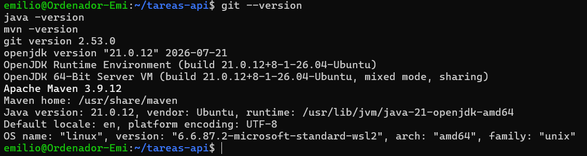
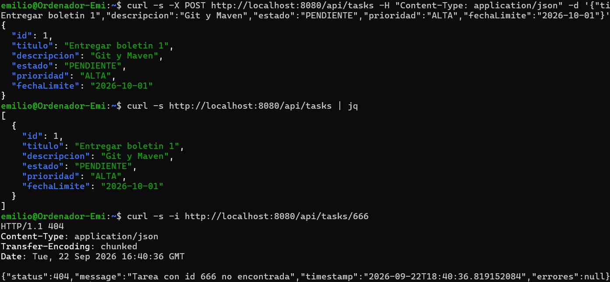
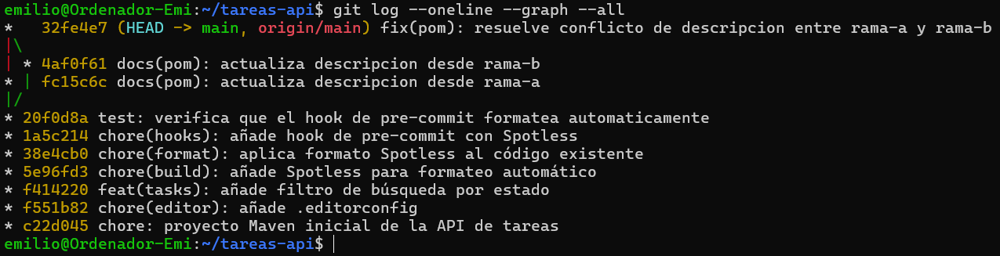

# Boletín 1

> Repositorio: https://github.com/EmilioG999/PracticasContinuas-MISUM  
> Pareja: Emilio González (@EmilioG999) y Manuel (@manuel-umu)

## Resumen de commits

| # | Mensaje del commit | Qué se hizo | Autor | Enlace |
|---|--------------------|-------------|-------|--------|
| 1 | `chore: proyecto Maven inicial de la API de tareas` | Estructura inicial del proyecto Maven (`pom.xml`, entidad `Task`, capas controlador/servicio/repositorio, manejo de errores, tests unitarios) | Emilio González | [c22d045](https://github.com/EmilioG999/PracticasContinuas-MISUM/commit/c22d045) |
| 2 | `chore(editor): añade .editorconfig` | Añade `.editorconfig` para unificar indentación entre editores | Emilio González | [f551b82](https://github.com/EmilioG999/PracticasContinuas-MISUM/commit/f551b82) |
| 3 | `feat(tasks): añade filtro de búsqueda por estado` | Nuevo endpoint `GET /api/tasks?estado=` para filtrar tareas por estado, desarrollado en rama `feat/filtro-por-estado` y fusionado con fast-forward | Emilio González | [f414220](https://github.com/EmilioG999/PracticasContinuas-MISUM/commit/f414220) |
| 4 | `chore(build): añade Spotless para formateo automático` | Añade el plugin `spotless-maven-plugin` al `pom.xml` | Emilio González | [5e96fd3](https://github.com/EmilioG999/PracticasContinuas-MISUM/commit/5e96fd3) |
| 5 | `chore(format): aplica formato Spotless al código existente` | Ejecuta `mvn spotless:apply` sobre todo el código fuente existente | Emilio González | [38e4cb0](https://github.com/EmilioG999/PracticasContinuas-MISUM/commit/38e4cb0) |
| 6 | `chore(hooks): añade hook de pre-commit con Spotless` | Añade `.githooks/pre-commit` (versionado) y configura `core.hooksPath` para formatear automáticamente antes de cada commit | Emilio González | [1a5c214](https://github.com/EmilioG999/PracticasContinuas-MISUM/commit/1a5c214) |
| 7 | `test: verifica que el hook de pre-commit formatea automaticamente` | Commit de prueba: Se desordena a propósito la indentación de `EstadoTarea.java` para comprobar que el hook la corrige antes de commitear | Emilio González | [20f0d8a](https://github.com/EmilioG999/PracticasContinuas-MISUM/commit/20f0d8a) |
| 8 | `docs(pom): actualiza descripcion desde rama-a` | Cambio de la descripción del `pom.xml` en `rama-a`, para provocar un conflicto de merge | Emilio González | [fc15c6c](https://github.com/EmilioG999/PracticasContinuas-MISUM/commit/fc15c6c) |
| 9 | `docs(pom): actualiza descripcion desde rama-b` | Cambio de la misma línea del `pom.xml` en `rama-b`, en paralelo a `rama-a` | Emilio González | [4af0f61](https://github.com/EmilioG999/PracticasContinuas-MISUM/commit/4af0f61) |
| 10 | `fix(pom): resuelve conflicto de descripcion entre rama-a y rama-b` | Commit de merge: resuelve a mano el conflicto entre `rama-a` y `rama-b` en `pom.xml` | Emilio González | [32fe4e7](https://github.com/EmilioG999/PracticasContinuas-MISUM/commit/32fe4e7) |

## Detalle por commit

### 1. `chore: proyecto Maven inicial de la API de tareas`
- **Qué se hizo:** Se generó desde cero un proyecto Maven con Spring Boot 3 y Java 21 (a partir del prompt dado en el boletín): una API REST de gestión de tareas (entidad `Task` con id, título, descripción, estado, prioridad y fecha límite), que usa Spring Data JPA con Hibernate para la persistencia y H2 en memoria como base de datos. Incluye endpoints CRUD completos, capa de servicio y repositorio JPA separados, validaciones con Bean Validation, manejo de errores centralizado con `@RestControllerAdvice` (404 para recurso no encontrado, 400 para validación), y 7 tests unitarios de reglas de negocio reales (validación de fecha límite futura, título no vacío, lógica del servicio con repositorio mockeado). Se configuró también `.gitignore` y `.gitattributes`.
- **Autor:** Emilio González.
- **Relación con el boletín:** Partes B, C y D (generación de la app con IA, construcción/prueba local, primer commit del repositorio dentro de la parte de control de versiones).
- **Uso de IA:** Claude (Claude Code). Se le pidió generar un proyecto Maven con Spring Boot 3 y Java 21, siguiendo el prompt de ejemplo del boletín. El código generado se revisó, se compiló y se probaron los endpoints con `curl` como se indicó antes de commitear.

### 2. `chore(editor): añade .editorconfig`
- **Qué se hizo:** Se añadió `.editorconfig` con indentación de 4 espacios para Java y 2 espacios para YAML/JSON.
- **Autor:** Emilio González.
- **Relación con el boletín:** Parte D (commit de configuración de editor, separado por tipo `chore`).
- **Uso de IA:** No. Código copiado del boletín.

### 3. `feat(tasks): añade filtro de búsqueda por estado`
- **Qué se hizo:** Se creó la rama `feat/filtro-por-estado` y se añadió un método `findByEstado` en el repositorio JPA, su implementación en la capa de servicio y un nuevo parámetro opcional `estado` en `GET /api/tasks`. Se compiló, se pasaron los 9 tests (7 originales + verificación manual con `curl`) y se fusionó en `main` con fast-forward.
- **Autor:** Emilio González.
- **Relación con el boletín:** Parte D (rama con cambio no trivial, commit y fusión).
- **Uso de IA:** Claude (Claude Code). Se le pidió un cambio no trivial sobre la API ya generada; propuso añadir un filtro por estado, indicando qué modificar en cada capa (repositorio, servicio, controlador). El código propuesto se revisó y se probaron de nuevo los endpoints con `curl` antes de commitear.

### 4. `chore(build): añade Spotless para formateo automático`
- **Qué se hizo:** Se añadió el plugin `spotless-maven-plugin` versión 2.43.0 al `pom.xml`, configurado con `googleJavaFormat`, eliminación de imports no usados, recorte de espacios en blanco al final de línea y salto de línea final obligatorio.
- **Autor:** Emilio González.
- **Relación con el boletín:** Parte E (configuración de Spotless).
- **Uso de IA:** No. Código copiado del boletín.

### 5. `chore(format): aplica formato Spotless al código existente`
- **Qué se hizo:** Se ejecutó `mvn spotless:apply`, que reformateó automáticamente los archivos del proyecto. Se verificó después con `mvn spotless:check` (sin violaciones) y `mvn clean package` (9 tests, BUILD SUCCESS).
- **Autor:** Emilio González.
- **Relación con el boletín:** Parte E (primera aplicación del formateo automático).
- **Uso de IA:** No. Ejecución directa de los comandos del boletín.

### 6. `chore(hooks): añade hook de pre-commit con Spotless`
- **Qué se hizo:** Se creó `.githooks/pre-commit` que ejecuta `mvn spotless:apply` y vuelve a añadir los archivos reformateados antes de cada commit. Se configuró `core.hooksPath .githooks` para que Git use esa carpeta.
- **Autor:** Emilio González.
- **Relación con el boletín:** Parte E (formateo automático de cada commit).
- **Uso de IA:** No. Código copiado del boletín.

### 7. `test: verifica que el hook de pre-commit formatea automaticamente`
- **Qué se hizo:** Se desordenó a propósito la indentación de `EstadoTarea.java` (líneas en blanco extra) y se hizo commit. El hook de pre-commit funcionó, ejecutó Spotless, corrigió el archivo y lo volvió a añadir automáticamente antes de completar el commit. Se verificó con `git show` y `git diff` que el archivo final quedó idéntico al ya formateado. Por tanto el código desordenado nunca llegó a entrar en el historial.
- **Autor:** Emilio González.
- **Relación con el boletín:** Parte E (comprobación de que el hook funciona).
- **Uso de IA:** No. Cambios en el espaciado a `EstadoTarea.java`.

### 8. `docs(pom): actualiza descripcion desde rama-a`
- **Qué se hizo:** Se creó `rama-a` desde `main` y se modificó la etiqueta `<description>` del `pom.xml`.
- **Autor:** Emilio González.
- **Relación con el boletín:** Parte F (primera rama para provocar el conflicto).
- **Uso de IA:** No.

### 9. `docs(pom): actualiza descripcion desde rama-b`
- **Qué se hizo:** Se creó `rama-b` desde el mismo punto de `main` (antes de fusionar `rama-a`) y se modificó la misma línea `<description>` del `pom.xml` con un valor distinto.
- **Autor:** Emilio González.
- **Relación con el boletín:** Parte F (segunda rama, para que el merge posterior genere un conflicto real).
- **Uso de IA:** No.

### 10. `fix(pom): resuelve conflicto de descripcion entre rama-a y rama-b`
- **Qué se hizo:** Al fusionar `rama-a` en `main` (fast-forward, sin conflicto) y después `rama-b`, Git marcó conflicto en `pom.xml` sobre la línea `<description>`. Se editó el archivo a mano, eliminando los marcadores `<<<<<<<`, `=======` y `>>>>>>>`, dejando una única versión final de la descripción, y se cerró el merge con `git add` y `git commit`.
- **Autor:** Emilio González.
- **Relación con el boletín:** Parte F (resolución manual del conflicto).
- **Uso de IA:** No.

## Descripción narrativa de lo hecho en la sesión y relación con los commits

### Parte A — Instalación y verificación del entorno

Se eligió realizar esta práctica con WSL, por lo que se instaló Ubuntu con `wsl --install -d Ubuntu`. Dentro de Ubuntu se instalaron Git 2.53.0, JDK 21.0.12 y Maven 3.9.12 con `sudo apt install -y git openjdk-21-jdk maven`. Se realizó la comprobación pertinente:

Además, se configuró la identidad de Git (`user.name`, `user.email`) y evitamos merges automáticos sorpresa (`pull.ff only`, `init.defaultBranch main`).

### Parte B — Generación de la API con IA

Se generó con Claude una API REST de gestión de tareas con Spring Boot 3, Java 21, Spring Data JPA y H2 en memoria, cumpliendo los requisitos mínimos del boletín (entidad con validaciones, CRUD, capas, manejo de errores, 7 tests de Spring y JAR ejecutable). Ver commit 1.

### Parte C — Construcción y prueba en local

Se descomprimió el proyecto en WSL respetando su estructura, posteriormente se ejecutó `mvn clean package` compiló correctamente y pasó los tests. Se arrancó la aplicación con `java -jar target/tareas-api-0.0.1-SNAPSHOT.jar` y se probaron los endpoints con `curl`: creación de tarea (`POST`), listado (`GET`) y comprobación del 404 (`GET /api/tasks/666`).

### Parte D — Control de versiones con Git

Se inicializó el repositorio (`git init`, `.gitignore`, `.gitattributes`) y se hizo el primer commit. Se añadió `.editorconfig` en un commit separado. Se creó la rama `feat/filtro-por-estado` con un cambio no trivial (filtro de tareas por estado), se probó y se fusionó en `main` con fast-forward. Ver commits 1, 2 y 3.

### Parte E — Formateo automático en cada commit

Se añadió Spotless al `pom.xml`, se aplicó sobre el código existente, y se automatizó con un hook de pre-commit versionado en `.githooks/pre-commit`. Se verificó el funcionamiento del hook desordenando a propósito un archivo y comprobando que el commit resultante contenía la versión ya formateada. Ver commits 4, 5, 6 y 7.

### Parte F — Provocar y resolver un conflicto

Se crearon dos ramas (`rama-a`, `rama-b`) desde el mismo punto de `main`, modificando ambas la misma línea (`<description>` del `pom.xml`) con valores distintos. Se fusionó `rama-a` en `main` sin conflicto (fast-forward). Al fusionar `rama-b`, Git marcó conflicto real en esa línea; se resolvió manualmente eliminando los marcadores de conflicto y dejando la versión final, cerrando con un commit de merge. Ver commits 8, 9 y 10.

