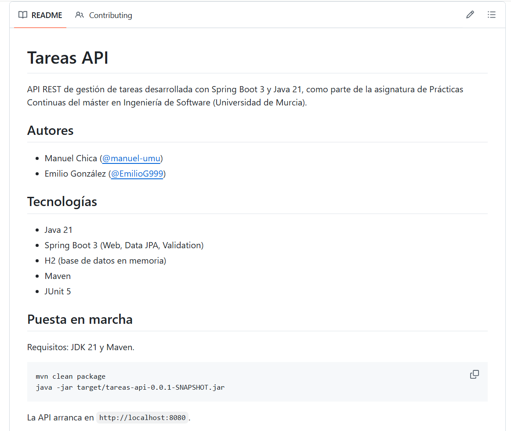
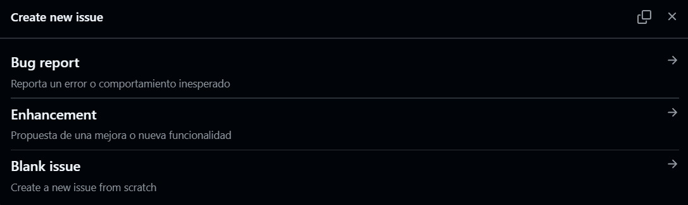
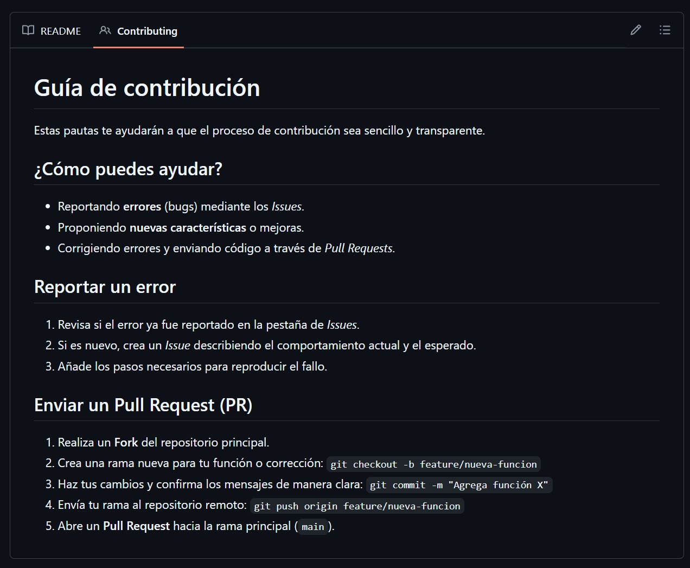
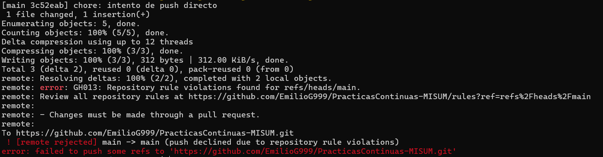
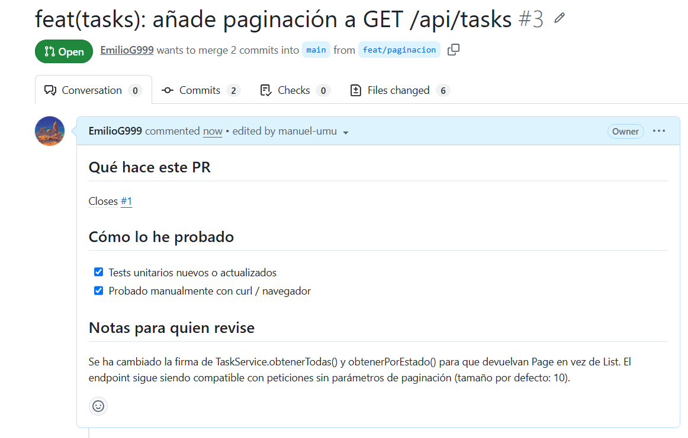
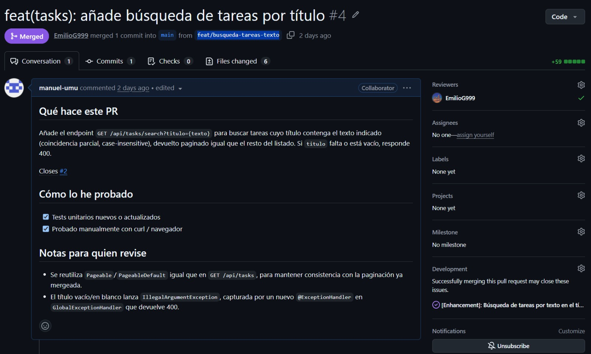
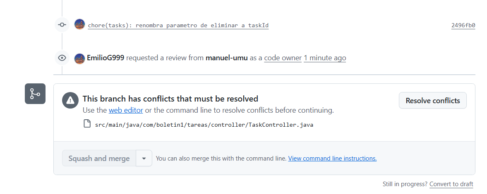
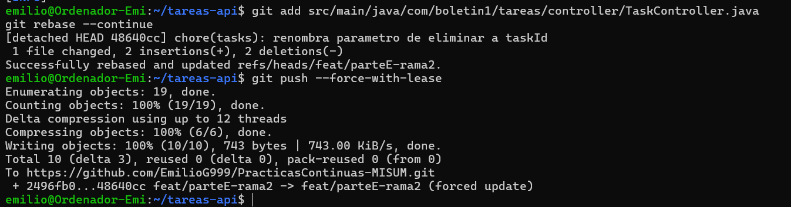
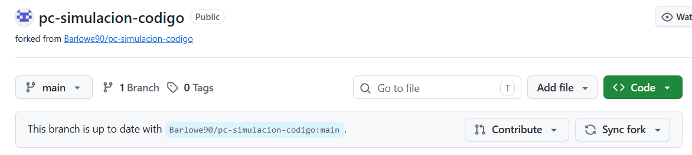
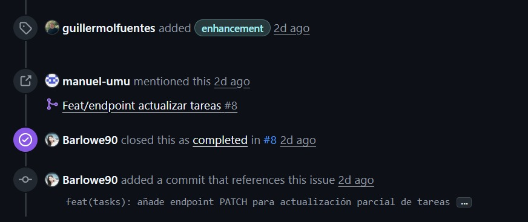

# Boletín 2

> Repositorio: https://github.com/EmilioG999/PracticasContinuas-MISUM  
> Pareja: Emilio González (@EmilioG999) y Manuel (@manuel-umu)

## Resumen de commits

| # | Mensaje del commit | Qué se hizo | Autor | Enlace |
|---|--------------------|-------------|-------|--------|
| 1 | `chore: añadido readme, plantillas issues/PRs, CODEOWNERS, CONTRIBUTING y README` | Añade `.github/PULL_REQUEST_TEMPLATE.md`, `.github/ISSUE_TEMPLATE/`, `.github/CODEOWNERS` y `CONTRIBUTING.md` | Manuel Chica | [88890b2](https://github.com/EmilioG999/PracticasContinuas-MISUM/commit/88890b2) |
| 2 | `chore: intento de push directo` | Commit de prueba para demostrar el bloqueo del Ruleset: push directo a `main` rechazado por GitHub (`GH013`) | Emilio González | [3c52eab](https://github.com/EmilioG999/PracticasContinuas-MISUM/commit/3c52eab) |
| 3 | `feat(tasks): añade paginación a GET /api/tasks` | Añade paginación (`Page`, `Pageable`, `@PageableDefault`) en rama `feat/paginacion` | Emilio González | [6592d6e](https://github.com/EmilioG999/PracticasContinuas-MISUM/commit/6592d6e) |
| 4 | `feat(tasks): añade paginación a GET /api/tasks (#3)` | Squash-and-merge del PR #3 (paginación) sobre `main`, revisado y aprobado por Manuel | Emilio González | [71ede85](https://github.com/EmilioG999/PracticasContinuas-MISUM/commit/71ede85) |
| 5 | `feat(tasks): añade búsqueda de tareas por título` | Añade `GET /api/tasks/search?titulo=` en rama `feat/busqueda-tareas-texto` | Manuel Chica | [e11eed8](https://github.com/EmilioG999/PracticasContinuas-MISUM/commit/e11eed8) |
| 6 | `feat(tasks): añade búsqueda de tareas por título (#4)` | Squash-and-merge del PR #4 (búsqueda por título) sobre `main`, revisado y aprobado por Emilio | Manuel Chica | [c3be85b](https://github.com/EmilioG999/PracticasContinuas-MISUM/commit/c3be85b) |
| 7 | `fix: Nombre variable` | Renombra el parámetro de `eliminar` a `idTarea`, en rama `feat/parteE-Rama1` | Manuel Chica | [1f9a219](https://github.com/EmilioG999/PracticasContinuas-MISUM/commit/1f9a219) |
| 8 | `fix: Nombre variable (#5)` | Squash-and-merge del PR #5 (`feat/parteE-Rama1`) sobre `main`, sin conflicto | Manuel Chica | [1677e5f](https://github.com/EmilioG999/PracticasContinuas-MISUM/commit/1677e5f) |
| 9 | `chore(tasks): renombra parametro de eliminar a taskId` | Renombra el mismo parámetro a `taskId` en `feat/parteE-rama2`, en paralelo a la Rama1. Después del rebase sobre `main` actualizado, se resolvió el conflicto a mano (`idParaEliminar`) | Emilio González | [48640cc](https://github.com/EmilioG999/PracticasContinuas-MISUM/commit/48640cc) |
| 10 | `chore(tasks): renombra parametro de eliminar a taskId (#6)` | Squash-and-merge del PR #6 (`feat/parteE-rama2`) sobre `main`, cierra la Parte E con el nombre final `idParaEliminar` | Emilio González | [2699ec6](https://github.com/EmilioG999/PracticasContinuas-MISUM/commit/2699ec6) |
| 11 | `Feature/filter tasks by priority (#8)` | Squash-and-merge del PR #8, abierto por `guillermolfuentes` (otra pareja) resolviendo un issue no trivial de nuestro repositorio | Guillermo Fuentes | [6d252c0](https://github.com/EmilioG999/PracticasContinuas-MISUM/commit/6d252c0) |
| 12 | `fix(tasks): valida transición de estado en patchTask` | Añade `validateTransition` al endpoint `PATCH`. PR abierto desde el fork de Manuel (`manuel-umu/pc-simulacion-codigo`) sobre el repo original (`Barlowe90/pc-simulacion-codigo`), aceptado y fusionado | Emilio González | [92a2590](https://github.com/Barlowe90/pc-simulacion-codigo/commit/92a2590) |
 

## Detalle por commit

### 1. `chore: añadido readme, plantillas issues/PRs, CODEOWNERS, CONTRIBUTING y README`
- **Qué se hizo:** Se crearon las plantillas de issues y PRs y los ficheros CODEOWNERS.md, CONTRIBUTING.md y README.md
- **Autor:** Manuel Chica.
- **Relación con el boletín:** Parte B (plantillas de PR/issues, CODEOWNERS, CONTRIBUTING).
- **Uso de IA:** Contenido del CONTRIBUTING.md
- Los dos siguientes commits, `fix: Movidas plantillas issue y PR` y `fix: Plantilla PR en carpeta correcta` fueron commits porque las plantillas no estaban en la carpeta correcta.

### 2. `chore: intento de push directo`
- **Qué se hizo:** Una vez aplicado el Ruleset pedido en la Parte C del boletín sobre `main` (requiere PR + 1 aprobación de Code Owner), se intentó un `git push` directo a `main` para comprobar que la protección se aplicaba correctamente. Se rechazó el push con el error `GH013: Repository rule violations found`, como era esperado.
- **Autor:** Emilio González.
- **Relación con el boletín:** Parte C (verificación de que la protección de rama con Ruleset bloquea push directo).
- **Uso de IA:** No. Paso a paso hecho como se indica en el boletín.

### 3. `feat(tasks): añade paginación a GET /api/tasks`
- **Qué se hizo:** Se creó la rama `feat/paginacion` y se añadió paginación al endpoint `GET /api/tasks` un nuevo parámetro `Pageable` en el controlador, y sus correspondientes modificaciones en`TaskService`/`TaskServiceImpl` para devolver `Page<Task>` en lugar de `List<Task>`, tanto en el listado general como en el filtro por estado. Se probó con `curl` y con tests unitarios antes de abrir el PR.
- **Autor:** Emilio González.
- **Relación con el boletín:** Parte D (ciclo 1 hecho por Emilio).
- **Uso de IA:** Claude (Claude Code). Se pidió implementar paginación en controlador, servicio, repositorio y generar los tests correspondientes.

### 4. `feat(tasks): añade paginación a GET /api/tasks (#3)`
- **Qué se hizo:** Manuel revisó el PR #3 (paginación) como reviewer, lo aprobó, y se completó el squash-and-merge sobre `main`, terminando el primer ciclo de PR con roles autor/revisor.
- **Autor:** Emilio González (autor del PR), Manuel Chica (revisor).
- **Relación con el boletín:** Parte D (ciclo 1 hecho por Emilio).
- **Uso de IA:** No. PR hecho a mano.

### 5. `feat(tasks): añade búsqueda de tareas por título`
- **Qué se hizo:** Se creó la rama `feat/busqueda-tareas-texto` y se creó el endpoint `GET /api/tasks/search?titulo={texto}` para buscar tareas por titulo.
- **Autor:** Manuel Chica.
- **Relación con el boletín:** Parte D (ciclo 2 hecho por Manuel).
- **Uso de IA:** Claude (Claude Code). Para la generación del código del endpoint.

### 6. `feat(tasks): añade búsqueda de tareas por título (#4)`
- **Qué se hizo:** Emilio revisó el PR #4 (búsqueda por título) como reviewer, lo aprobó, y se completó el squash-and-merge sobre `main`, terminando el segundo ciclo de PR con roles autor/revisor.
- **Autor:** Manuel Chica (autor del PR) y Emilio González (revisor).
- **Relación con el boletín:** Parte D (ciclo 2 hecho por Manuel).
- **Uso de IA:** No. PR hecho a mano.

### 7. `fix: Nombre variable`
- **Qué se hizo:** Se creó la rama `feat/parteE-rama1` y se renombró el parámetro del método `eliminar` en `TaskController.java` a `idTarea`.
- **Autor:** Manuel Chica.
- **Relación con el boletín:** Parte E (primera rama).
- **Uso de IA:** No.

### 8. `fix: Nombre variable (#5)`
- **Qué se hizo:** Se hizo el PR correspondiente, y se hizo merge. No provocó ningún problema, ya que es el primero de los dos PRs de esta parte.
- **Autor:** Manuel Chica (autor del PR), Emilio González (revisor).
- **Relación con el boletín:** Parte E (primera rama, primer PR, sin conflicto).
- **Uso de IA:** No. PR cerrado a mano.

### 9. `chore(tasks): renombra parametro de eliminar a taskId`
- **Qué se hizo:** Se creó la rama `feat/parteE-rama2` desde el mismo punto de `main` que `feat/parteE-Rama1` de Manuel, y se renombró el mismo parámetro del método `eliminar` en `TaskController.java`, en este caso a `taskId`. Al hacer `git rebase origin/main` tras el merge de la rama de Manuel, Git marcó un conflicto en esa línea. Se resolvió manualmente editando el archivo, eliminando los marcadores y unificando el nombre final a `idParaEliminar`, completando con `git rebase --continue` y `git push --force-with-lease` como indica el boletín.
- **Autor:** Emilio González.
- **Relación con el boletín:** Parte E (segunda rama, provoca y resuelve el conflicto de fusión real).
- **Uso de IA:** No. Cambio hecho a mano con `rebase` y `push` hechos como indica el boletín.

### 10. `chore(tasks): renombra parametro de eliminar a taskId (#6)`
- **Qué se hizo:** Squash-and-merge del PR #6 (`feat/parteE-rama2` → `main`), tras la resolución manual del conflicto. Se verificó con `mvn clean package` (14 tests, BUILD SUCCESS) antes de fusionar.
- **Autor:** Emilio González.
- **Relación con el boletín:** Parte E (cierre del PR con el conflicto ya resuelto).
- **Uso de IA:** No. PR cerrado a mano.

### 11. `feat(tasks): añade endpoint PATCH para actualización parcial de tareas`
- **Qué se hizo:** _**Commit en el fork del repositorio de la otra pareja*_. Se añadió el endpoint para actualizar parcialmente las tareas. No incluye la validación de transición de estado antes de asignar el nuevo estado.
- **Autor:** Manuel Chica.
- **Relación con el boletín:** Parte F (resolución de un issue no trivial en el repositorio de otra pareja a partir de un fork).
- **Uso de IA:** Claude (Claude Code). Para la generación del código del endpoint.

### 12. `fix(tasks): valida transición de estado en patchTask`
- **Qué se hizo:** El endpoint `PATCH /tasks/{id}` de `pc-simulacion-codigo` (repo de la otra pareja) aplicaba el nuevo estado sin pasar por la validación de transición de estado que sí aplicaba `updateTask` (no permitir salir de `CANCELLED`, no permitir volver de `DONE` a `PENDING`). Se añadió la llamada a `validateTransition(task.getStatus(), request.getStatus())` antes de asignar el nuevo estado. Se verificó que compilaba y pasaban los tests (`mvn clean package`, `BUILD SUCCESS`) antes de commitear.
- **Autor:** Emilio González.
- **Relación con el boletín:** Parte F (resolución de un issue no trivial en el repositorio de otra pareja a partir de un fork).
- **Uso de IA:** Claude (Claude Code). Se le pidió identificar el problema a partir del código con el TODO de Manuel. El cambio se aplicó y se verificó localmente antes de commitear.

## Descripción narrativa de lo hecho en la sesión y relación con los commits

### Parte A — Publicar el repositorio

Se hizo público el repositorio `PracticasContinuas-MISUM` y se añadió a Manuel como colaborador. Posteriormente se completó el `README` aportando descripción, requisitos, cómo construir, cómo arrancar y cómo activar los hooks del Boletín 1.

### Parte B — Gobernanza del repositorio

Primeramente se creó la plantilla para los Pull Request en `.github/PULL_REQUEST_TEMPLATE.md` copiando la plantilla del boletín. Luego se investigo en Google que son las etiquetas de Issues y se creó las plantillas de mejora (Enhancement) y bug, ambas en `.github/ISSUE_TEMPLATE/`.

Lo siguiente fue crear el fichero CODEOWNERS para que automáticamente asigne las revisiones de los Pull Request a nosotros mismos.

Luego se debatió entre los dos integrantes del equipo **qué** estrategia de fusión de PRs escoger por defecto. Al final se decidió por la de **Squash and Merge**, ya que Rebase and Merge incluiría los commits de la rama que se esta mergeando, y eso en nuestra opinión quedaría menos limpio.

Finalmente se creó el fichero `CONTRIBUTING.md` con las pautas para contribuir al proyecto y se hizo push para subir todos los cambios. Se comprobó que efectivamente, Github detecta las plantillas y los ficheros `CONTRIBUTING.md` y `CODEOWNERS.md`.

### Parte C — Proteger la rama main

Se configuró un Ruleset sobre `main` exigiendo: pull request obligatorio, al menos 1 aprobación de Code Owner, sin que nadie pueda saltarse la regla y prohibición de force-push/borrado de la rama. Se verificó el bloqueo intentando un push directo a `main`, que GitHub rechazó con el error `GH013: Repository rule violations found`.

### Parte D — Trabajo por Pull Requests

**Ciclo 1:** Emilio desarrolló la paginación de `GET /api/tasks` (rama `feat/paginacion`), abrió PR, y Manuel  lo revisó y lo aprobó.

**Ciclo 2:** Manuel desarrolló un nuevo endpoint para la búsqueda de tareas por título: `GET /api/tasks/search` (rama `feat/busqueda-tareas-texto`), abrió PR, y Emilio lo revisó y lo aprobó.

### Parte E — Provocar un conflicto en un PR

Se crearon dos ramas desde el mismo punto de `main` (`feat/parteE-rama1` de Manuel y `feat/parteE-rama2` de Emilio), ambas modificando el nombre del parámetro del método `eliminar` en `TaskController.java` (a `idTarea` y `taskId` respectivamente). La primera rama se fusionó sin conflicto. Al hacer rebase de la segunda rama sobre el `main` actualizado, Git marcó conflicto real en esa línea.

Se resolvió manualmente, eliminando los marcadores de conflicto y unificando el nombre a `idParaEliminar`, y se completó con `git rebase --continue` + `git push --force-with-lease` (necesario por haberse reescrito el historial de la rama tras el rebase). Se verificó con `mvn clean package` (14 tests, BUILD SUCCESS) antes del squash-and-merge.

### Parte F — PR con fork

La otra pareja creó un Issue no trivial en su repositorio (`Barlowe90/pc-simulacion-codigo`): _"Añadir un endpoint PATCH /api/v1/tasks/{id} que permita actualizar únicamente los campos enviados en el cuerpo de la petición, sin necesidad de enviar el recurso completo como exige el PUT actual."_

El primer paso fue hacer un fork del repositorio, siguiendo de una rama para desarrollar la funcionalidad: `manuel-umu:feat/endpoint-actualizar-tareas`.

Se implementó la funcionalidad reutilizando el método `validateTransition` ya existente en la clase. Se verificó que compilaba y pasaban los tests antes de commitear y hacer push a la rama del fork.

Por último se hizo PR desde el fork hacia el repositorio original, donde la otra pareja revisó el codigo y acepto los cambios. 

En paralelo a todo este proceso, la otra pareja hizo lo mismo pero con nuestro repositorio: fork, desarrollo de la solución, push a su fork, PR y merge.

