# Boletín 3

> Repositorio: https://github.com/EmilioG999/PracticasContinuas-MISUM  
> Pareja: Emilio González (@EmilioG999) y Manuel (@manuel-umu)

## Resumen de commits

| # | Mensaje del commit | Qué se hizo | Autor | Enlace |
|---|--------------------|-------------|-------|--------|
| 1 | feat(health): añade Spring Boot Actuator y expone /actuator/health | Añade `spring-boot-starter-actuator` y expone `/actuator/health` | `Emilio González` | [53102a0](https://github.com/EmilioG999/PracticasContinuas-MISUM/commit/53102a0) |
| 2 | feat: Dockerfile y DockerIgnore | Añade `Dockerfile` y `.dockerignore` | `Manuel Chica` | [79f49e9](https://github.com/EmilioG999/PracticasContinuas-MISUM/commit/79f49e9) |
| 3 | feat(db): sustituye H2 por PostgreSQL y añade docker-compose.yml | Sustituye H2 por PostgreSQL (driver + `application.properties`). Además añade `docker-compose.yml` (servicios `db` + `api`, healthcheck y volumen) | `Emilio González` | [e4bf383](https://github.com/EmilioG999/PracticasContinuas-MISUM/commit/e4bf383) |
| 4 | chore: env y variables en docker compose | Creación del `env` y modificación del `docker-compose.yml` con variables de entorno del env.| `Manuel Chica` | [ee2b1d7](https://github.com/EmilioG999/PracticasContinuas-MISUM/commit/ee2b1d7) |
| 5 | chore(devcontainers): carpeta y fichero para devcontainer | Se creó el fichero `.devcontainer/devcontainer.json` | `Manuel Chica` | [fe6035b](https://github.com/EmilioG999/PracticasContinuas-MISUM/commit/fe6035b) |
| 6 | docs(readme): documenta Docker Compose y Dev Container | Documentación actualizada en `README.md` | `Emilio González` | [2751db2](https://github.com/EmilioG999/PracticasContinuas-MISUM/commit/2751db2) |

## Detalle por commit

### 1. `feat(health): añade Spring Boot Actuator y expone /actuator/health`
- **Qué se hizo:** Se añadió la dependencia de Spring Boot Actuator en el `pom.xml`, modificó `application.properties` y expuso `/actuator/health`.
- **Autor:** Emilio González.
- **Relación con el boletín:** Parte B (endpoint de salud con Actuator).
- **Uso de IA:** No. Copiado del boletín.

### 2. `feat: Dockerfile y DockerIgnore`
- **Qué se hizo:** Creación y configuración de los ficheros Dockerfile y dockerignore.
- **Autor:** Manuel Chica.
- **Relación con el boletín:** Parte C (Dockerfile multi-stage).
- **Uso de IA:** No.

### 3. `feat(db): sustituye H2 por PostgreSQL y añade docker-compose.yml`
- **Qué se hizo:** Se sustituyó la base de datos H2 a PostgreSQL manteniendo Spring Data JPA con Hibernate como capa de persistencia y se creó el `docker-compose.yml` dado en el boletín con los correspondientes servicios `db` y `api`.
- **Autor:** Emilio González.
- **Relación con el boletín:** Parte D (de H2 a PostgreSQL con Compose).
- **Uso de IA:** Claude (Claude Code). Se utilizó el prompt de ejemplo del boletín para sustituir H2 y actualizar correspondientemente `application.properties`.

### 4. `chore: env y variables en docker compose`
- **Qué se hizo:** Creación del env y modificación del docker-compose.yml con variables de entorno del env.
- **Autor:** Manuel Chica.
- **Relación con el boletín:** Parte E (sacar la configuración a un fichero .env).
- **Uso de IA:** No.

### 5. `chore(devcontainers): carpeta y fichero para devcontainer`
- **Qué se hizo:** Se creó el fichero `.devcontainer/devcontainer.json`
- **Autor:** Manuel Chica.
- **Relación con el boletín:** Parte F (Dev container).
- **Uso de IA:** No.

### 6. `docs(readme): documenta Docker Compose y Dev Container`
- **Qué se hizo:** Se completó el `README.md` con la puesta en marcha de Docker Compose y Dev Container.
- **Autor:** Emilio González.
- **Relación con el boletín:** Parte G (documentación).
- **Uso de IA:** No.


## Descripción narrativa de lo hecho en la sesión y relación con los commits


### Parte A — Primeros pasos con Docker

Una vez instalado Docker Desktop se comprobó la salida de los siguientes comandos para su correcto funcionamiento: `docker --version`, `docker compose version` y `docker run hello-world`.

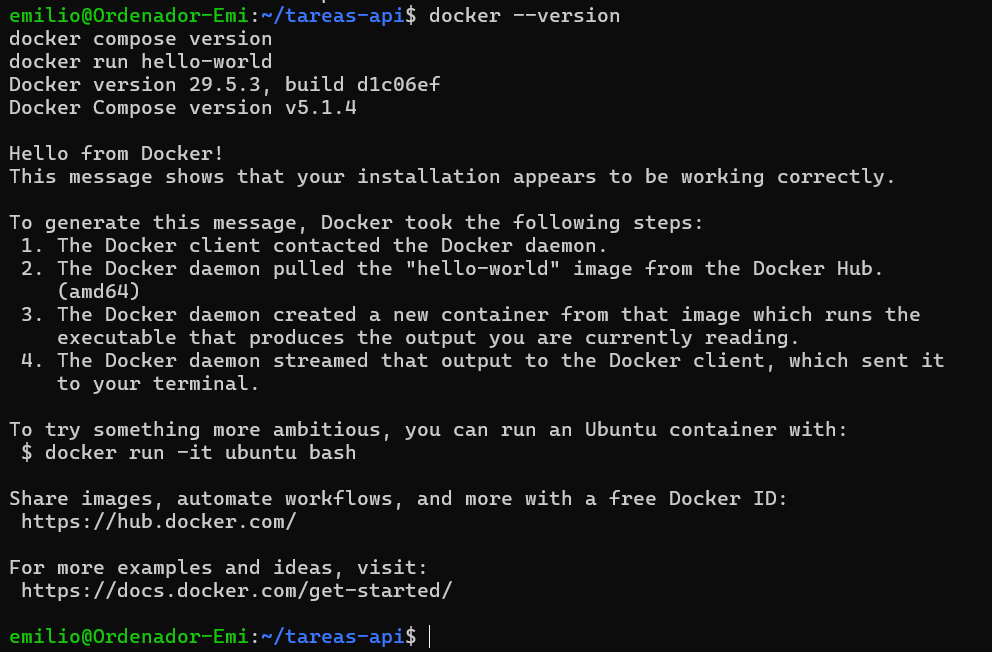


### Parte B — Endpoint de salud

Se añadió la dependencia `spring-boot-starter-actuator` al `pom.xml` y se configuró en `application.properties` la exposición únicamente de los endpoints `health` e `info`. Posteriormente se comprobó que `curl http://localhost:8080/actuator/health` devuelve `{"status":"UP"}`.

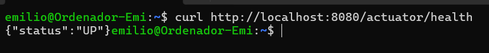


### Parte C — Dockerfile multi-stage

1 - Se han creado los ficheros `Dockerfile` y `dockerignore` con los ejemplos dle boletín.
2 - Se ha construido la imagen y arrancado un contenedor

```bash
docker build -t tareas-api:0.1 .
docker run --rm -p 8080:8080 tareas-api:0.1
# En otra terminal:
curl http://localhost:8080/api/tasks
```

La salida del `docker ps` se muestra a continuación:
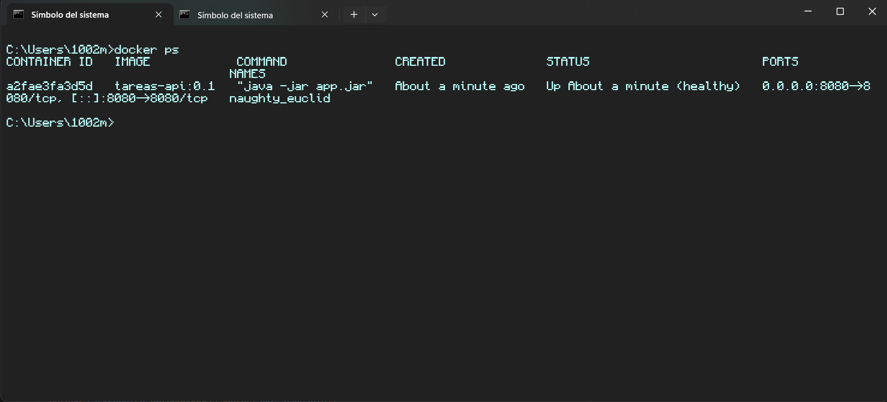

Lo siguiente fue construir de nuevo, pero con el parametro `--target`, para comparar el tamaño de ambas imagenes, lo cual se muestra en la siguiente imagen:

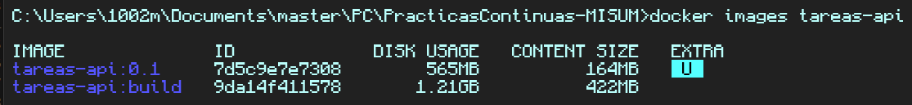

Como se ve, la imagen con target ocupa más del doble. Esto es porque con ese parametro Docker se para en dicha etapa, la cual es la más grande ya que incluye:

* JDK en lugar del JRE
* Dependencias
* Codigo fuente
* Ficheros intermedios (target/classes, etc)

En una construcción normal, Docker en la última etapa solo copia el .jar compilado, sin dependencias ni codigo fuente ni nada de lo citado.

#### Cache de capas
Se modificó una linea de java, antes y después de cambiar el Dockerfile, moviendo `COPY src ./src` por encima del `COPY pom.xml`. A continuación se muestran ambas reconstrucciones:

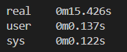
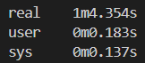

Esto es porque cada instrucción del `Dockerfile` es una capa, esto significa que si construyes una vez, cada capa se guarda en cache, y si se modifica alguna capa, todas las siguientes se invalidan y se deben volver a construir. Por eso, al tener `src` por debajo del `pom.xml` y del `dependency:go-offline`, al modificarse, no se tienen que descargar las dependencias; cosa que si pasa al mover `src` por encima de estas.


### Parte D — De H2 a PostgreSQL con Compose

#### D.1 Cambiar la base de datos

Se pidió a la IA que sustituyese H2 por el driver de PostgreSQL a partir del siguiente prompt: "Modifica ligeramente el proyecto existente para sustituir la base de datos H2 en memoria por PostgreSQL, manteniendo Spring Data JPA con Hibernate como capa de persistencia".

Consiguiendo por tanto en `application.properties` la siguiente línea: `spring.jpa.hibernate.ddl-auto=update`. De esta manera la imagen arrancará con Compose y no con `docker run`.

#### D.2 docker-compose.yml

Se creó en la raíz el `docker-compose.yml` dado en el boletín con los correspondientes servicios `db` y `api`:

```bash
services:
  db:
    image: postgres:16
    environment:
      POSTGRES_DB: tareas
      POSTGRES_USER: app
      POSTGRES_PASSWORD: secret_local_dev
    ports: ["127.0.0.1:5432:5432"]
    volumes:
      - db-data:/var/lib/postgresql/data
    healthcheck:
      test: ["CMD-SHELL", "pg_isready -U app -d tareas"]
      interval: 5s
      timeout: 3s
      retries: 10

  api:
    build: .
    ports: ["8080:8080"]
    environment:
      SPRING_DATASOURCE_URL: jdbc:postgresql://db:5432/tareas
      SPRING_DATASOURCE_USERNAME: app
      SPRING_DATASOURCE_PASSWORD: secret_local_dev
    depends_on:
      db:
        condition: service_healthy

volumes:
  db-data:
```

#### D.3 Comprobar la persistencia

Se levantó todo el stack y se comprobó el estado de los servicios:

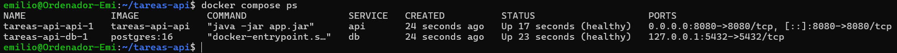

Posteriormente se introdujó un dato con `curl -X POST http://localhost:8080/api/tasks`, se procedió a parar con `docker compose down` y levantar el stack con `docker compose up -d` para comprobar que el dato seguía ahi:

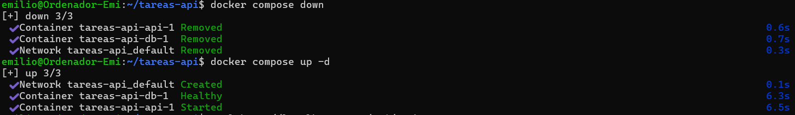

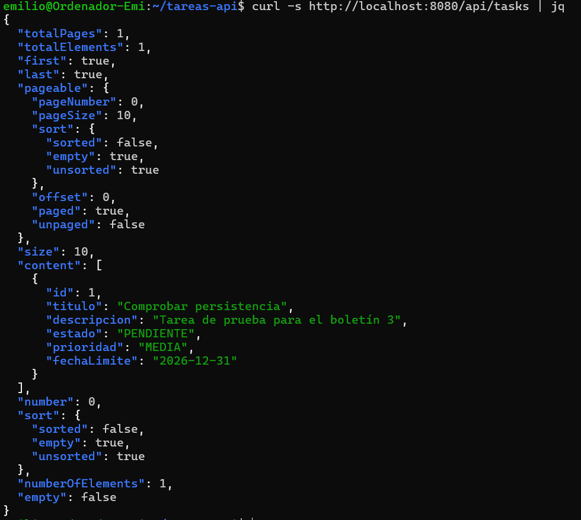

Repitiendo esta operación de parar el stack con `docker compose down -v` y levantando con`docker compose up -d` podemos observar como se muestra la lista vacía:

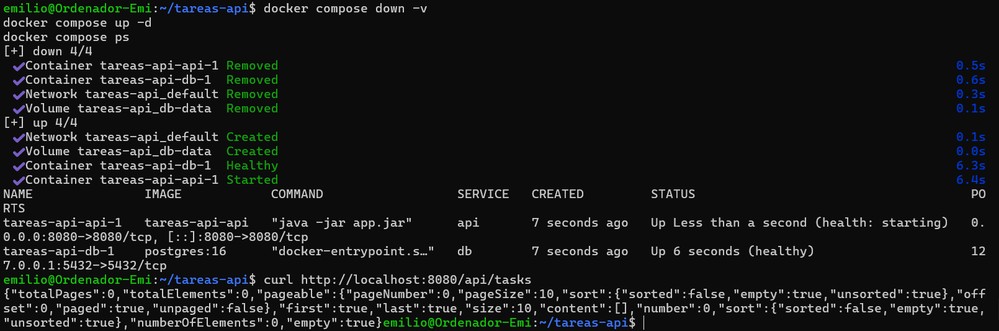

El motivo por el que esto ocurre se debe a que `down` borra los contenedores conservando los datos, mientras que `down -v` también borra los volúmenes asociados y por tanto los datos.


### Parte E — Sacar la configuración a un fichero `.env`

Se creó la plantilla `env.example` con el ejemplo del boletín y se copió a un `.env
` local. Lo siguiente fue protegerlo, ya que es el fichero que contiene todos los datos importantes del proyecto (contraseñas, claves, etc). Para ello, se añadió al fichero `.gitignore`, para que no se suba al repositorio. Lo mismo con `dockerignore`, aunque en este caso ya estaba incluido. A continuación se modificó el `docker-compose.yml` para evitar tener credenciales en claro y que utilizará las del env. Para ello se utilizaron variables de 3 tipos: `${VAR}`, `${VAR:?mensaje}` y `$${VAR}`.

Por último, se comprobó que la configuración era correcta con `docker compose config` y se arrancó el proyecto:

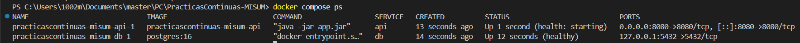
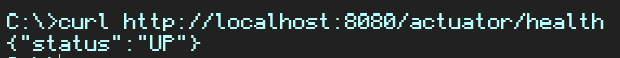


### Parte F — Dev container

Se instaló la extensión de `Dev Containers` para definir el entorno de desarrollo de Docker. Luego se créo el fichero `.devcontainer/devcontainer.json` con la configuración del boletín.

```bash
{
  "name": "tareas-api",
  "image": "mcr.microsoft.com/devcontainers/java:21",
  "features": {
    "ghcr.io/devcontainers/features/java:1": { "installMaven": "true" },
    "ghcr.io/devcontainers/features/docker-in-docker:2": { "moby": false }
  },
  "forwardPorts": [8080, 5432],
  "postCreateCommand": "test -f .env || cp .env.example .env; if [ -d .githooks ]; then git config core.hooksPath .githooks; fi; mvn -B dependency:go-offline",
  "customizations": {
    "vscode": { "extensions": ["vscjava.vscode-java-pack", "ms-azuretools.vscode-docker"] }
  }
}
```
Como se ve, tiene varios parametros, de los cuales se van a desglosar los más importantes a continuación:


| Parametro | Qué hace |
|---|---|
| docker-in-docker | Instala y arranca un daemon de Docker dentro del devcontainer, lo que permite ejecutar `docker compose up` dentro del entorno, sin depender del host. |
| postCreateCommand | Ejecuta los siguientes comandos después de crear el devcontainer: 1. `test -f .env \|\| cp .env.example .env` comprueba si existe el env, en cuyo caso contrario lo crearía copiando el env.example. 2. `if [ -d .githooks ]; then git config core.hooksPath .githooks; fi` Si hay una carpeta `githooks` le dice a Git que los use, en lugar de los de `.git/hooks`. 3. `mvn -B dependency:go-offline` hace que Maven descargue las dependencias y las guarde en el repositorio (~/.m2), para que los empaquetados o arraques posteriores sean más rapidos. |

Tras esto, se ejecuto el comando `Dev Containers: Reopen in Container` en la barra de VS Code para acceder a la consola de DevContainers. Dentro de esta se construyó la imagen con `docker compose up --build` (cosa posible gracias al parametro docker-in-docker, explicado antes) y se comprobó que funciona con un curl a la dirección `http://127.0.0.1:8080/actuator/health`


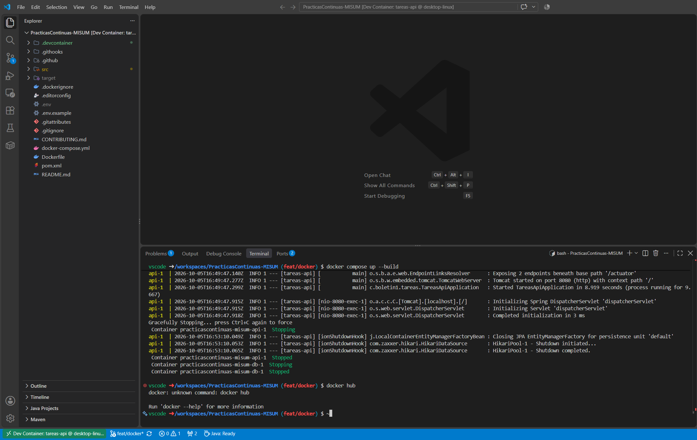

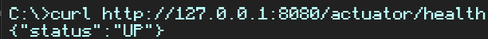

### Parte G — Versionar los cambios

Emilio modificó el `README.md` para documentar la puesta en marcha con Docker y Dev Container.


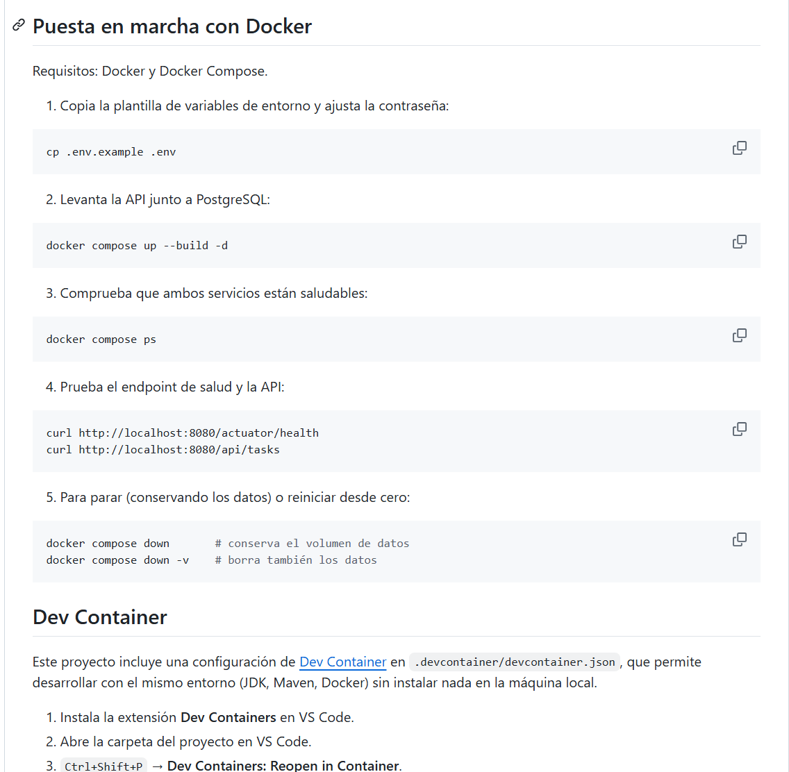


Manuel hizo Pull Request con todos los cambios (rama feat/docker) y Emilio lo revisó y aprobó.


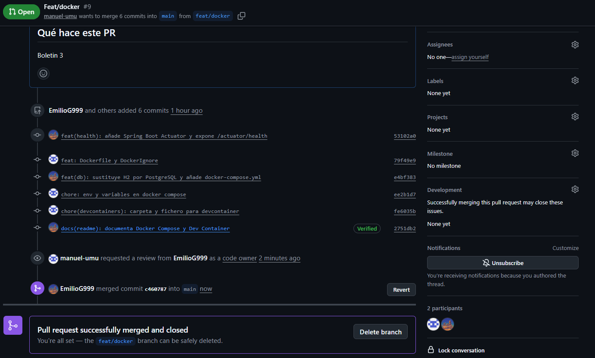


### Parte H — Registry de Docker

Se han seguido los siguientes pasos:

1. Crear una cuenta en Docker.

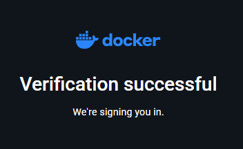

2. Ponerle nombre a la imagen que se va a subir.(docker-compose.yml) (No se ha hecho commit).

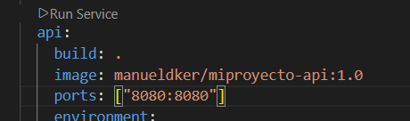

3. Construir y subir:

```bash
docker login
docker compose build api
docker compose push api
```

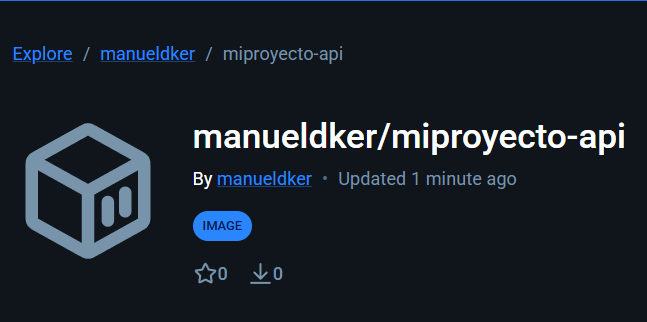


### Parte I — Entorno de pruebas reproducible

1. Para realizar este apartado se escogió el repositorio de GitHub: [`psf/requests`](https://github.com/psf/requests) (>52.000 estrellas), la librería HTTP estándar de Python.

2. Respecto a sus requisitos se cita las fuentes del propio repositorio:
    - **Lenguaje/versión**: Python 3.10+ (indicado en el `README`: "Requests officially supports Python 3.10+").
    - **Gestor de paquetes**: `pip`.
    - **Dependencias de test**: listadas en `requirements-dev.txt` (`pytest`, `pytest-cov`, `pytest-httpbin==2.1.0`, `httpbin~=0.10.0`, `trustme`, `wheel`).
    - **Comando de test**: según el target `test` del `Makefile` del proyecto, `python -m pytest tests`.

3. Se clonó el repositorio en una carpeta separada (`~/boletin3-parteI/requests`) y se creó un `Dockerfile` (en `~/boletin3-parteI/docker-env/`) el cual se pidió a Claude indicándole que instale únicamente las herramientas de test en la etapa de build:

```bash
FROM python:3.12-slim
WORKDIR /app

RUN pip install --no-cache-dir \
      pytest \
      pytest-cov \
      "pytest-httpbin==2.1.0" \
      "httpbin~=0.10.0" \
      trustme \
      wheel

CMD ["sh", "-c", "pip install -e .[socks] -q && python -m pytest tests"]
```

El código fuente de `requests` se montó como volumen en tiempo de ejecución (`docker run --rm -v ~/boletin3-parteI/requests:/app requests-tests`). El propio contenedor instala `requests` y ejecuta `python -m pytest tests`.

4. Tras construir la imagen (`docker build -t requests-tests .`) y ejecutar el contenedor, se obtuvieron los resultados: **619 passed, 15 skipped, 1 xfailed, 18 warnings en 81.35 s**, sobre los 635 tests totales.

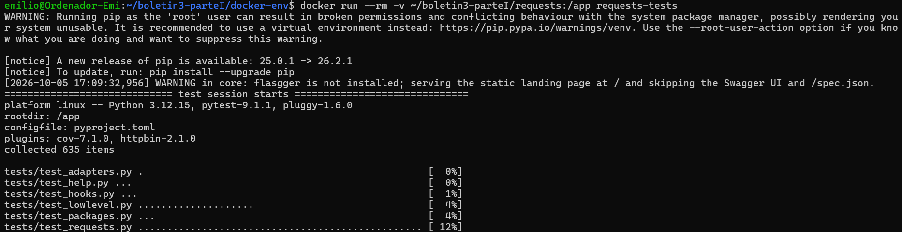

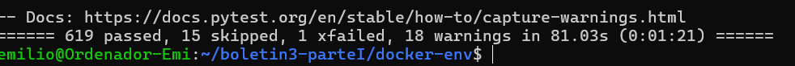

Esto confirma que el entorno reproducido en Docker es equivalente al necesario para ejecutar los tests del proyecto original, sin depender de la configuración de la máquina local.


