# Boletín 4

> Repositorio: https://github.com/EmilioG999/PracticasContinuas-MISUM  
> Pareja: Emilio González (@EmilioG999) y Manuel Chica (@manuel-umu)

## Resumen de commits

| # | Mensaje del commit | Qué se hizo | Autor | Enlace |
|---|--------------------|-------------|-------|--------|
| 1 | ci: añadido pipeline ci | Añade `.github/workflows/ci.yml` con el job `build` | `Manuel Chica` | [cdea054](https://github.com/EmilioG999/PracticasContinuas-MISUM/commit/cdea0541401853ed1461188e082e36c0ff4c75db) |
| 2 | test: modificado test para que falle el ci | Rompe un test a propósito para demostrar el CI en rojo | `Manuel Chica` | [4e36992](https://github.com/EmilioG999/PracticasContinuas-MISUM/commit/4e3699273b99ac101fd7004e27653016a145e305) |
| 3 | fix: test ahora funciona | Arregla el test y el CI vuelve a verde | `Manuel Chica` | [eb0143](https://github.com/EmilioG999/PracticasContinuas-MISUM/commit/eb0143ee081bc271f569ea22f93e65f9513babac) |
| 4 | ci: separa el pipeline en jobs lint, test y package | Reestructura `ci.yml` en `lint`, `test`, `package` encadenados con `needs` | `Emilio González` | [0c03497](http://github.com/EmilioG999/PracticasContinuas-MISUM/commit/0c034978146e3e97aca3102b9c43d7699f62132f) |
| 5 | chore: provoca fallo de formato real para probar el job lint | Provoca un fallo de `lint` con `git commit --no-verify` | `Emilio González` | [6b8e437](https://github.com/EmilioG999/PracticasContinuas-MISUM/commit/6b8e437136f26b4c1c423cc131aec5cd6108f67c) |
| 6 | style: aplica formato de Spotless a EstadoTarea.java | Corrige el formato, pipeline completo en verde | `Emilio González` | [a4278e2](https://github.com/EmilioG999/PracticasContinuas-MISUM/commit/a4278e2dee427e63101e8358c3708d651acaec29) |
| 7 | test: rompe una aserción a propósito para verificar la barrera de status checks | Commit de prueba para comprobar que GitHub impide fusionar un PR con un test roto | `Emilio González` | [c0cd569](https://github.com/EmilioG999/PracticasContinuas-MISUM/commit/c0cd56963a4bad1eec25e6e8d07f60ea8013956a) |
| 8 | ci: workflow de ia | Workflow que comenta el PR con un resumen generado por IA, token gestionado como secreto | `Manuel Chica` | [ba7e917](https://github.com/EmilioG999/PracticasContinuas-MISUM/commit/ba7e917e09c61fe30b507d055f3ba13e2b75910b) |
| 9 | Add CI badge to README | Añadir badge del CI a README.md | `Manuel Chica` |[be8d328](https://github.com/EmilioG999/PracticasContinuas-MISUM/commit/be8d328d0eb2987afeb017fe81bb62bafec80afd) |

## Detalle por commit

### 1. `ci: añadido pipeline ci`
- **Qué se hizo:** Se creó el fichero `.github/workflows/ci.yml` con el contenido del boletín.
- **Autor:** Manuel Chica.
- **Relación con el boletín:** Parte A (primer pipeline de CI).
- **Uso de IA:** No.

### 2. `test: modificado test para que falle el ci`
- **Qué se hizo:** Se modifico un test aleatorio para probar el pipeline de CI y comprobar que al hacer PR, este falla ya que el workflow que se ha subido antes detecta el test fallido.
- **Autor:** Manuel Chica.
- **Relación con el boletín:** Parte B (Demostrar que el CI atrapa errores).
- **Uso de IA:** No.

### 3. `fix: test ahora funciona` 
- **Qué se hizo:** Arreglar el test que fallaba y comprobar que el PR ahora si sale verde.
- **Autor:** Manuel Chica.
- **Relación con el boletín:** Parte B (Demostrar que el CI atrapa errores).
- **Uso de IA:** No.

### 4. `ci: separa el pipeline en jobs lint, test y package`
- **Qué se hizo:** Se reestructuró `ci.yml`, pasando de un único job a tres jobs encadenados con `needs` (`lint` → `test` → `package`). `lint` ejecuta `mvn spotless:check`; `test` ejecuta `mvn verify` y publica el informe JUnit con `dorny/test-reporter` (con `if: always()` para que se publique incluso si los tests fallan); `package` ejecuta `mvn package -DskipTests` y sube el `.jar` como artefacto con `actions/upload-artifact`.
- **Autor:** Emilio González.
- **Relación con el boletín:** Parte C (separar responsabilidades en jobs).
- **Uso de IA:** No. Código copiado del boletín.

### 5. `chore: provoca fallo de formato real para probar el job lint`
- **Qué se hizo:** Se provocó un fallo de formato en `EstadoTarea.java` (una línea con indentación incorrecta) y se commiteó con `--no-verify` para saltar el hook de pre-commit. Se pusheó para comprobar en Actions que `lint` fallaba y que `test`/`package` no llegaban a ejecutarse por la dependencia `needs`.
- **Autor:** Emilio González.
- **Relación con el boletín:** Parte C (separar responsabilidades en jobs).
- **Uso de IA:** No.

### 6. `style: aplica formato de Spotless a EstadoTarea.java`
- **Qué se hizo:** Se ejecutó `mvn spotless:apply` para corregir automáticamente la indentación del commit anterior. Tras este push, los tres jobs (`lint`, `test`, `package`) del pipeline pasaron a verde.
- **Autor:** Emilio González.
- **Relación con el boletín:** Parte C (separar responsabilidades en jobs).
- **Uso de IA:** No.

### 7. `test: rompe una aserción a propósito para verificar la barrera de status checks`
- **Qué se hizo:** Sobre una rama nueva (`test/verificar-barrera-ci`) creada desde `main`, se modificó una aserción del test `crearGuardaLaTareaConIdNulo` en `TaskServiceImplTest` y se pusheó para abrir un PR contra `main`. Se comprobó que el check `test` se ponía en rojo y que se bloqueaba el botón de squash-and-merge. Se corrigió la aserción, se pusheó de nuevo, y se confirmó que los tres checks pasaban a verde y el botón de squash-and-merge se desbloqueaba.
- **Autor:** Emilio González.
- **Relación con el boletín:** Parte D (convertir el CI en una barrera).
- **Uso de IA:** No.

### 8. `ci: workflow de ia`
- **Qué se hizo:** Se creó el workflow `ia.yml` que salta para cada PR. Su funcionamiento es leer el diff (cortando a los 10000 carácteres) y utilizar una API KEY de Ollama para explicar que hace el PR. Se utiliza curl para hacer la peticion y se genera un comentario en el PR con la respuesta de la IA.
- **Autor:** Manuel Chica.
- **Relación con el boletín:** Parte E (Ampliaciones interesantes).
- **Uso de IA:** Preguntar como hacer la parte del run (y los dos parametros `GH_TOKEN` y `GH_REPO`).

### 9. `Add CI badge to README`
- **Qué se hizo:** Añadir el badge de CI al README.
- **Autor:** Manuel Chica.
- **Relación con el boletín:** Parte E (Ampliaciones interesantes).
- **Uso de IA:** Buscar como se hace el badge.

## Descripción narrativa de lo hecho en la sesión y relación con los commits

### Parte A — Primer pipeline de CI

Creación de `.github/workflows/ci.yml` con el job `build`. `concurrency` agrupa ejecuciones de la misma rama y cancela las obsoletas al llegar un push nuevo. El workflow se dispara e cada `push` a `main` y en cada `pull_request`.

### Parte B — Demostrar que el CI atrapa errores

Se modificó un test para que el CI del Pull Requeste falle, cosa que se puede ver en la siguiente captura:

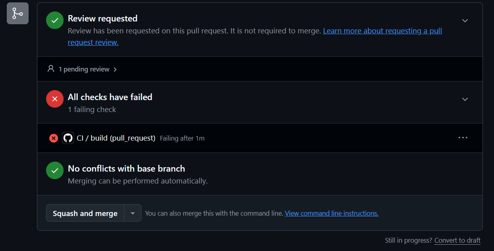

Luego se corrigió y pasó en verde:

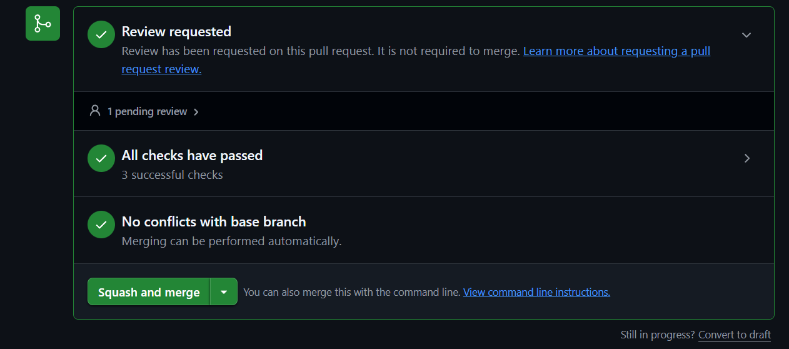

### Parte C — Separar responsabilidades en jobs

Se reestructuró `ci.yml`, pasando de un único job a tres jobs encadenados con `needs` (`lint` → `test` → `package`) con `permissions` ajustados (`contents: read`, `actions: read`, `checks: write`)

Posteriormente se cometió un fallo de formato y se commiteo sin verificar (`git commit --no-verify`). Donde se detiene el pipeline en `lint` sin llegar a ejecutar `test` ni `package`.

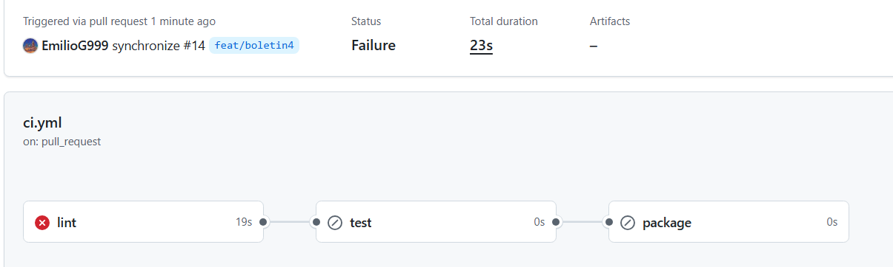

**Explica por qué es útil que lint vaya primero y por qué el paso del informe lleva if: always().**

El formateo debe de realizarse al principio ya que si el código está mal formateado es inútil continuar el pipeline de CI. Por otro lado, el paso del informe usa `if: always()` para que se publique el informe de tests incluso si algún test falla, de esta manera se podrían depurar con más facilidad los errores.

Aquí podemos ver la corrección del fallo y pipeline completo en verde, con el informe de tests y el JAR generados.

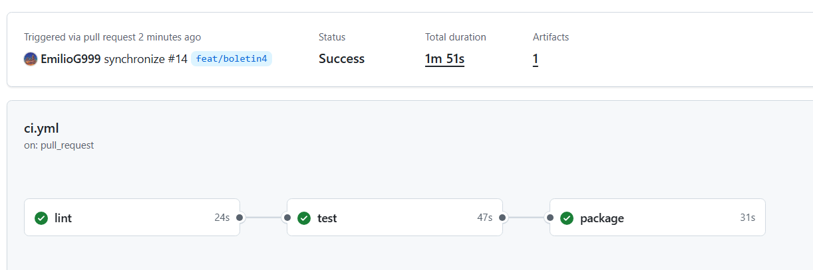

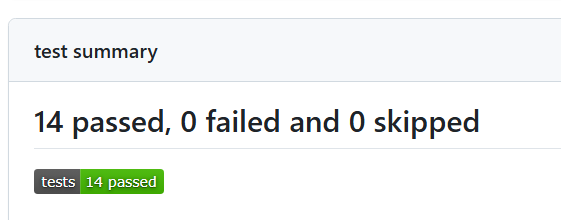

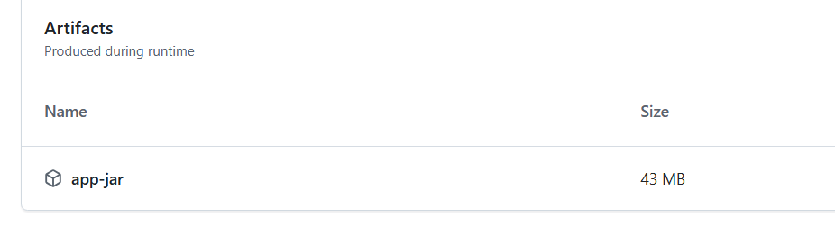

**¿Por qué el job package debe volver a construir el proyecto si el job test ya ha ejecutado mvn verify? ¿Cómo podrían compartirse los archivos generados entre ambos jobs?**

Con `package` se reconstruye el proyecto ya que cada job se ejecuta en un entorno aislado e independiente. Para compartir archivos entre jobs, se puede usar `actions/upload-artifact` en `test` y `actions/download-artifact` en `package` para evitar una nueva compilación.

### Parte D — Convertir el CI en una barrera

En `Settings → Branches`, se activa la opción: “Require status checks to pass before merging”, añadiendo los checks lint, test y package, marcando también “Require branches to be up to date before merging”. De esta manera se obliga a actualizar la rama del PR respecto a main antes de fusionarla, cuando esta última haya avanzado.

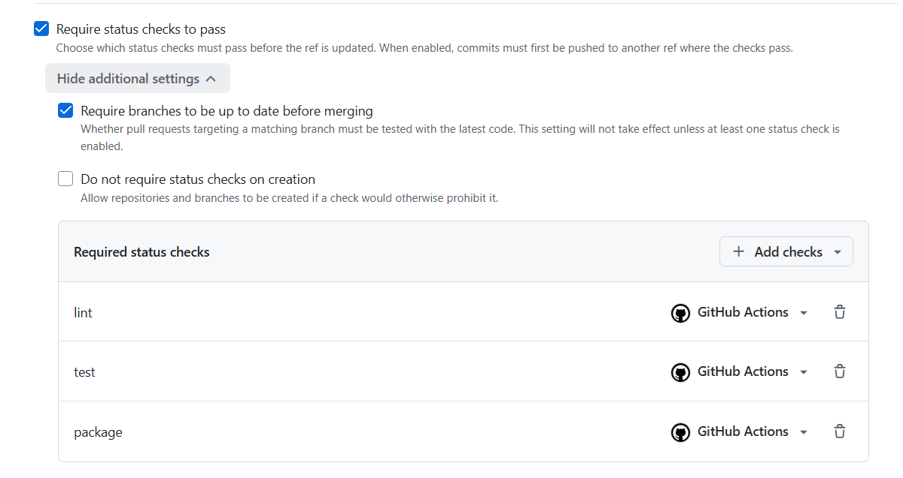

Se abrió un PR desde una nueva rama (`test/verificar-barrera-ci`) con un test roto y se comprobó que no se podía realizar el squash-and-merge.

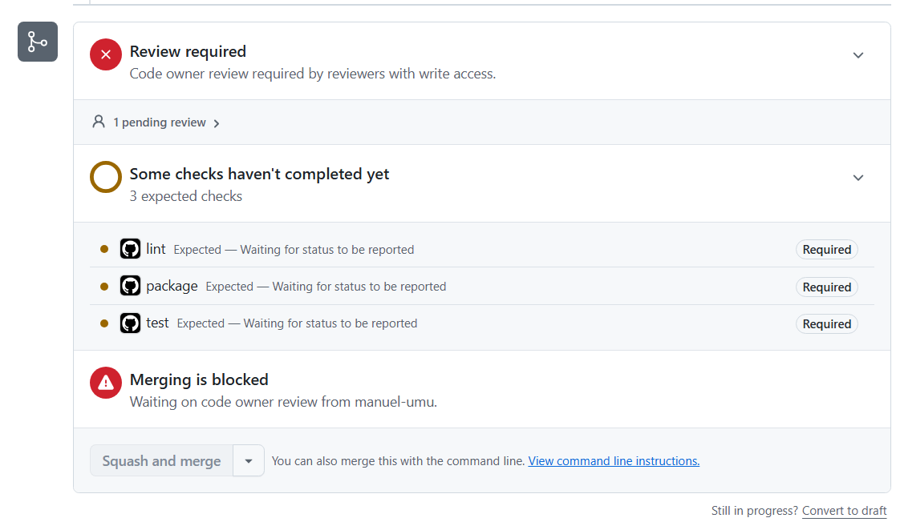

Una vez se aplicó la corrección a este test, GitHub permitió la fusión con el pipeline en verde.

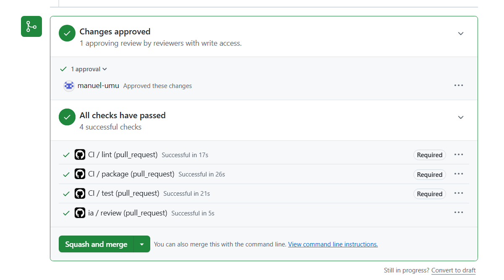

### Parte E — Ampliaciones interesantes

Se buscó la forma de hacer un workflow de revisión de PRs con IA. Primeramente se intentó utilizar Grok, ya que no encontrabamos el plan Free de Ollama, pero dió problemas y al final seguimos con Ollama. El token se gestiona como secreto de repositorio (`Settings → Secrets and variables → Actions`). Se hace una petición a la API por cada PR y se crea un comentario con la respuesta, o "La ia ha fallado" si no hay respuesta.

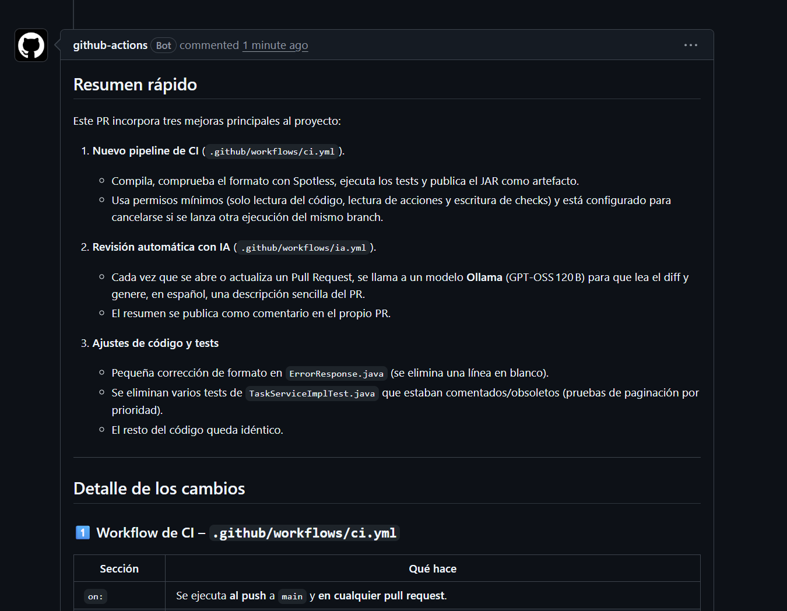

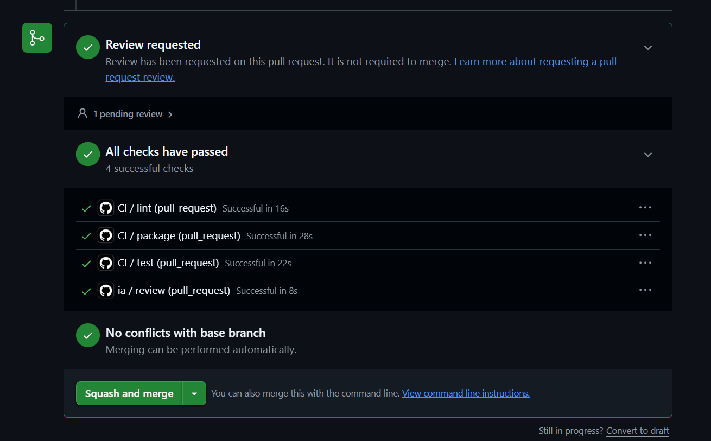

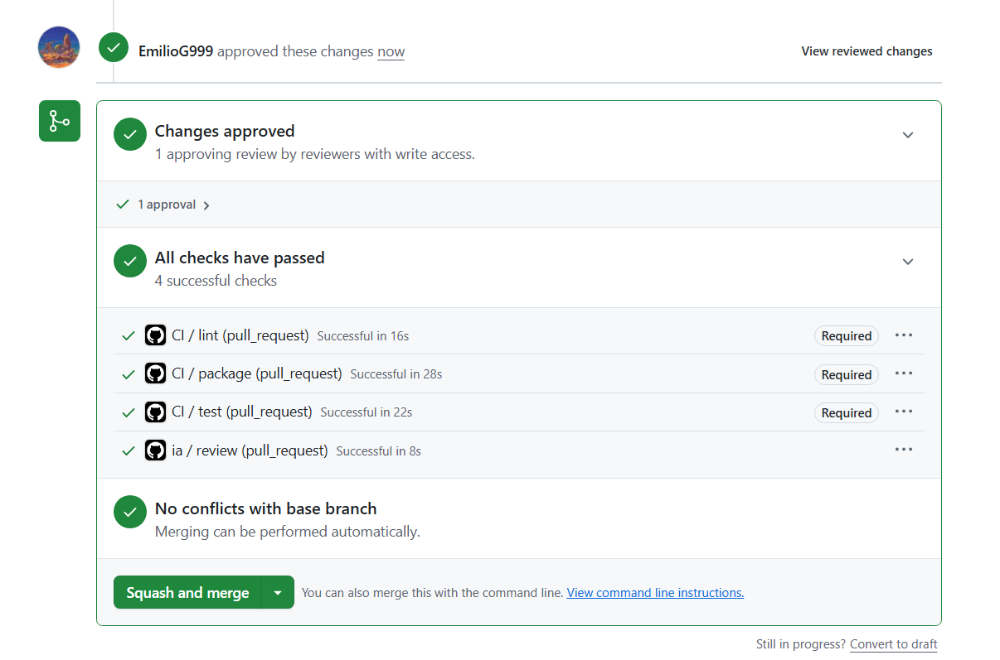