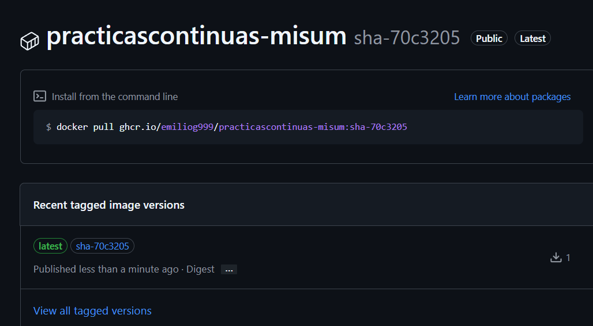
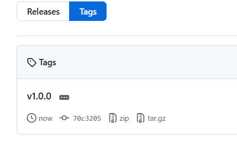
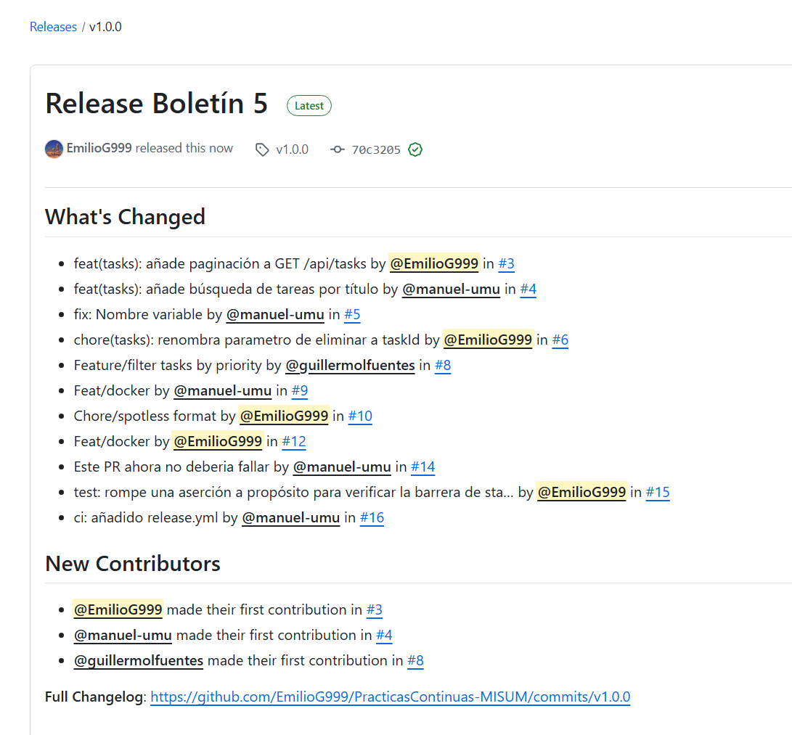
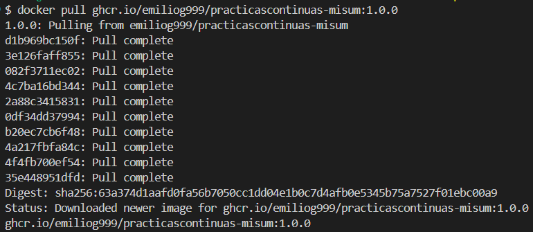
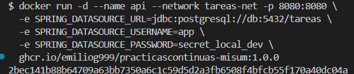
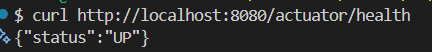
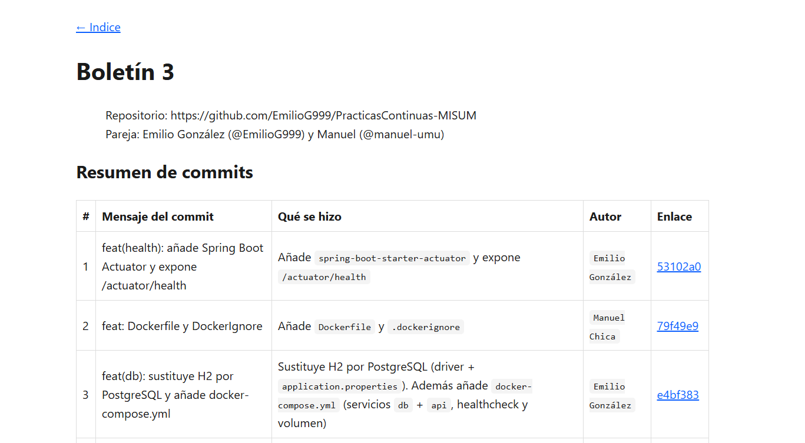

# Boletín 5

> Repositorio: https://github.com/EmilioG999/PracticasContinuas-MISUM  
> Pareja: Emilio González (@EmilioG999) y Manuel Chica (@manuel-umu)

## Resumen de commits

| # | Mensaje del commit | Qué se hizo | Autor | Enlace |
|---|--------------------|-------------|-------|--------|
| 1 | ci: añadido release.yml | Añade `.github/workflows/release.yml` (build + push a GHCR con tags) | `Manuel Chica` | [2ee9185](https://github.com/EmilioG999/PracticasContinuas-MISUM/commit/2ee91850e5a36f9e1aecaf4671dc6872fa9caa2a) |
| 2 | docs: añade boletines 1-3 y script de generación del sitio de documentación| Copia `boletinX.md` a `docs/`, script de generación de HTML, workflow `pages.yml` | `Emilio González` | [fc1256e](https://github.com/EmilioG999/PracticasContinuas-MISUM/commit/fc1256ee6e294b95a4dc420575c45e822bc6d5fe) |

## Detalle por commit

### 1. `ci: añadido release.yml`
- **Qué se hizo:** Se añadio un workflow `release.yml` con el contenido del boletín.
- **Autor:** Manuel Chica.
- **Relación con el boletín:** Parte A (pipeline de publicación de la imagen).
- **Uso de IA:** No.

### 2. `docs: añade boletines 1-3 y script de generación del sitio de documentación`
- **Qué se hizo:** Se creó la carpeta `docs/` en la raíz del repositorio, con una subcarpeta por boletín (`docs/boletin1/`, `docs/boletin2/`, `docs/boletin3/`), cada una con su `boletinX.md` y su carpeta `capturas/` correspondiente. Se escribió `docs/generate_site.py`, un script en Python que recorre esas subcarpetas, convierte cada `.md` a HTML y genera un `index.html` general que enlaza a todos los boletines, dejando el resultado en `docs/site/`. Se probó en local sirviendo `docs/site/` con `python3 -m http.server` y revisando en el navegador que el índice y las imágenes se mostraban correctamente. Se añadió `docs/site/` al `.gitignore` y se trabajó en una rama nueva (`feat/pages-docs`).
- **Autor:** Emilio González.
- **Relación con el boletín:** Parte D (GitHub Pages de la documentación).
- **Uso de IA:** Claude (Claude Code). Para la generación del script de Python que convierte los `.md` a HTML y la generación del workflow `pages.yml` que ejecuta el script y publica en `docs/site/` en GitHub Pages.

## Descripción narrativa de lo hecho en la sesión y relación con los commits

### Parte A — Pipeline de publicación

Se creó `release.yml`, que se ejecuta al hacer push a `main` y en tags `v*.*.*`. Al fusionar a `main` se generan los tags `sha-<commit>` y `latest`; al publicar una etiqueta `vX.Y.Z` se generan además `X.Y.Z`, `X.Y` y `X` (vía `docker/metadata-action` con los patrones `semver`). Luego se comprobó que la imagen aparece en la pestaña **Packages**, etiquetada con el SHA y `latest`.



### Parte B — Publicar una versión de verdad

Se creó una etiqueta anotada y se subió con: `git tag -a v1.0.0 -m "Primera versión publicable de la API de tareas"` + `git push origin v1.0.0`

Una vez que el workflow se dispara de nuevo vemos que la imagen aparece ahora también como 1.0.0, 1.0 y 1.



Posteriormente se creó la Release en GitHub a partir de esa etiqueta, con notas describiendo los cambios a partir de “Generate release notes”.




### Parte C — Verificar la imagen publicada

Se descargó la imagen publicada y se ejecutaron los comandos recomendados en el boletín para levantar un contenedor PostgreSQL y un contenedor de la API:





Finalmente se comprobó que todo habia salido bien con un curl: 
`curl http://localhost:8080/actuator/health` -> `UP`



Por último se limpio todo con un `docker rm`.


### Parte D — GitHub Pages de la documentación


Se movieron los documentos de los boletines a `docs/` en el repositorio. 
Posteriormente se creó un script con Claude en python que lee los .md en `docs/` y genera para cada uno, un .html equivalente junto con un `index.html` que enlace a todos. Estos se acaban guardando en `docs/site/`.

```bash
#!/usr/bin/env python3
"""Genera docs/site/ a partir de las carpetas boletinX/ en docs/."""
import pathlib
import re
import shutil
import markdown

DOCS_DIR = pathlib.Path(__file__).parent
SITE_DIR = DOCS_DIR / "site"

TEMPLATE = """<!DOCTYPE html>
<html lang="es">
<head>
<meta charset="utf-8">
<title>{title}</title>
<style>
  body {{ font-family: system-ui, sans-serif; max-width: 860px; margin: 2rem auto; padding: 0 1rem; line-height: 1.6; color: #1a1a1a; }}
  img {{ max-width: 100%; }}
  pre {{ background: #f4f4f4; padding: 1rem; overflow-x: auto; border-radius: 6px; }}
  code {{ background: #f4f4f4; padding: 0.15rem 0.35rem; border-radius: 4px; }}
  pre code {{ background: none; padding: 0; }}
  table {{ border-collapse: collapse; width: 100%; }}
  th, td {{ border: 1px solid #ddd; padding: 0.5rem; text-align: left; }}
  a {{ color: #0b5fff; }}
  nav a {{ margin-right: 1rem; }}
</style>
</head>
<body>
<nav><a href="{nav_back}">&larr; Indice</a></nav>
{body}
</body>
</html>
"""

def titulo_de(md_text: str, fallback: str) -> str:
    m = re.search(r"^#\s+(.+)$", md_text, re.MULTILINE)
    return m.group(1).strip() if m else fallback

def main():
    if SITE_DIR.exists():
        shutil.rmtree(SITE_DIR)
    SITE_DIR.mkdir(parents=True)

    boletin_dirs = sorted(
        d for d in DOCS_DIR.iterdir()
        if d.is_dir() and d.name != "site" and (d / f"{d.name}.md").exists()
    )

    entradas = []
    for carpeta in boletin_dirs:
        nombre = carpeta.name
        md_path = carpeta / f"{nombre}.md"
        texto = md_path.read_text(encoding="utf-8")
        titulo = titulo_de(texto, nombre)
        html_body = markdown.markdown(
            texto, extensions=["extra", "tables", "fenced_code", "sane_lists"]
        )

        destino = SITE_DIR / nombre
        destino.mkdir(parents=True, exist_ok=True)

        capturas_src = carpeta / "capturas"
        if capturas_src.is_dir():
            shutil.copytree(capturas_src, destino / "capturas", dirs_exist_ok=True)

        html_final = TEMPLATE.format(title=titulo, body=html_body, nav_back="../index.html")
        (destino / "index.html").write_text(html_final, encoding="utf-8")
        entradas.append((nombre, titulo))

    items = "\n".join(
        f'<li><a href="{nombre}/index.html">{titulo}</a></li>' for nombre, titulo in entradas
    )
    index_body = f"<h1>Practicas Continuas - Documentacion</h1>\n<ul>\n{items}\n</ul>"
    (SITE_DIR / "index.html").write_text(
        TEMPLATE.format(title="Indice", body=index_body, nav_back="index.html"), encoding="utf-8"
    )
    print(f"Generadas {len(entradas)} paginas en {SITE_DIR}")

if __name__ == "__main__":
    main()
```


Por último se automatizó con un workflow `pages.yml` realizado con Claude, que, en cada push a main, ejecuta el script y publica en `docs/site/` en GitHub Pages con las acciones oficiales.

```bash
name: Pages

on:
  push:
    branches: [ main ]

permissions:
  contents: read
  pages: write
  id-token: write

concurrency:
  group: pages
  cancel-in-progress: false

jobs:
  build:
    runs-on: ubuntu-latest
    steps:
      - uses: actions/checkout@v4
      - uses: actions/setup-python@v5
        with:
          python-version: "3.12"
      - name: Instalar dependencias
        run: pip install markdown
      - name: Generar sitio
        run: python3 docs/generate_site.py
      - name: Configurar Pages
        uses: actions/configure-pages@v5
      - name: Subir artefacto
        uses: actions/upload-pages-artifact@v3
        with:
          path: docs/site

  deploy:
    needs: build
    runs-on: ubuntu-latest
    environment:
      name: github-pages
      url: ${{ steps.deployment.outputs.page_url }}
    steps:
      - name: Publicar en GitHub Pages
        id: deployment
        uses: actions/deploy-pages@v4
```
Se ajustó en `Settings → Pages` y cambió `Source` a `GitHub Actions`.
Por último se añadió `docs/site/` en el .gitignore para que no se suba al repositorio.
Comprobación final:


