# Boletín 6

> Repositorio: https://github.com/EmilioG999/PracticasContinuas-MISUM  
> Pareja: Emilio González (@EmilioG999) y Manuel Chica (@manuel-umu)

## Resumen de commits

| # | Mensaje del commit | Qué se hizo | Autor | Enlace |
|---|--------------------|-------------|-------|--------|
| 1 | `ci: añade requirements.yml con la collection para Ansible` | Declara la dependencia de `community.docker:3.7.0` en `deploy/requirements.yml` | Emilio González | [d7b68ae](https://github.com/EmilioG999/PracticasContinuas-MISUM/commit/d7b68ae) |
| 2 | `feat: añade docker-compose de la flota de servidores para Ansible (app1, app2, db1)` | Crea `deploy/servidores/docker-compose.yml` con los tres contenedores SSH que simulan la flota destino | Emilio González | [d3b1cf8](https://github.com/EmilioG999/PracticasContinuas-MISUM/commit/d3b1cf8) |
| 3 | `feat: inventory.inim para ansible` | Crea `deploy/inventory.ini`. | Manuel Chica | [45e0bdd](https://github.com/EmilioG999/PracticasContinuas-MISUM/commit/45e0bdd) |
| 4 | `ci: añadido playbook de despliegue` | Crea `deploy/deploy.yml`.| Manuel Chica | [3cb9a9b](https://github.com/EmilioG999/PracticasContinuas-MISUM/commit/3cb9a9b) |
| 5 | `ci: ansible vault` | Crea el Vault cifrado (`deploy/group_vars/servidores/vault.yml`) con `ghcr_user`, `ghcr_token`, `db_name`, `db_user`, `db_pass` | Manuel Chica | [9c42517](https://github.com/EmilioG999/PracticasContinuas-MISUM/commit/9c42517) |
| 6 | `ci: ampliado release.yml con deploy` | Amplia `release.yml`. | Manuel Chica | [413ca9b](https://github.com/EmilioG999/PracticasContinuas-MISUM/commit/413ca9b) |

## Detalle por commit


### 1. `ci: añade requirements.yml con la collection para Ansible`
- **Qué se hizo:** Se añadió la dependencia en el repositorio para que sea reproducible, en `deploy/requirements.yml`.
- **Autor:** Emilio González.
- **Relación con el boletín:** Parte A (instalar Ansible y sus dependencias).
- **Uso de IA:** No. Código copiado del boletín.

### 2. `feat: añade docker-compose de la flota de servidores para Ansible (app1, app2, db1)`
- **Qué se hizo:** Se creó `deploy/servidores/docker-compose.yml` con los tres contenedores, cada uno con SSH habilitado y accesible en un puerto distinto del anfitrión.
- **Autor:** Emilio González.
- **Relación con el boletín:** Parte B (preparar la flota de servidores destino).
- **Uso de IA:** No. Docker-compose copiado del boletín.

### 3. `feat: inventory.inim para ansible`
- **Qué se hizo:** Añade el fichero `deploy/inventory.ini` con el contenido del boletín.
- **Autor:** Manuel Chica.
- **Relación con el boletín:** Parte C (el inventario).
- **Uso de IA:** No.

### 4. `ci: añadido playbook de despliegue`
- **Qué se hizo:** Añade el fichero `deploy/deploy.yml` con el contenido del boletín, modificando la ruta de la imagen a descargar.
- **Autor:** Manuel Chica.
- **Relación con el boletín:** Parte D (el playbook de despliegue).
- **Uso de IA:** No.

### 5. `ci: ansible vault`
- **Qué se hizo:** Se ejecutó `ansible-vault create deploy/group_vars/servidores/vault.yml` para crear el fichero encriptado y se rellenó con las credenciales de `ghcr_user`, `ghcr_token`, `db_name`, `db_user` y `db_pass`.
- **Autor:** Manuel Chica.
- **Relación con el boletín:** Parte E (proteger las credenciales con Ansible Vault).
- **Uso de IA:** No.

### 6. `ci: ampliado release.yml con deploy`
- **Qué se hizo:** Modificar el fichero `.github/workflows/release.yml` añadiendo el job `deploy`.
- **Autor:** Manuel Chica.
- **Relación con el boletín:** G.3 (ampliar el release.yml).
- **Uso de IA:** No.


## Descripción narrativa de lo hecho en la sesión y relación con los commits

### Parte A — Instalar Ansible y sus dependencias

Primero se instaló la versión 2.16.3 de Ansible con `pipx install "ansible-core==2.16.3"`. Posteriormente se comprobó la correcta instalación con `ansible --version`.
El siguiente pasó fue instalar la collection que aporta los módulos de Docker con `ansible-galaxy collection install community.docker:3.7.0`.
La dependencia se declaró en el repositorio, en `deploy/requirements.yml`:

```bash
collections:
  - name: community.docker
    version: "3.7.0"
```

### Parte B — Preparar la flota de servidores destino

Para poder preparar los contenedores Linux con SSH que hacen de máquinas destino en nuestro ordenador, preparamos el `deploy/servidores/docker-compose.yml` con verificación manual por SSH:

```bash
services:
  app1:
    image: rastasheep/ubuntu-sshd:18.04
    container_name: app1
    privileged: true
    ports:
      - "2223:22"
      - "8081:8080"

  app2:
    image: rastasheep/ubuntu-sshd:18.04
    container_name: app2
    privileged: true
    ports:
      - "2224:22"
      - "8082:8080"

  db1:
    image: rastasheep/ubuntu-sshd:18.04
    container_name: db1
    privileged: true
    ports: [ "2225:22" ]
```

Posteriormente realizamos las comprobaciones de entrar por SSH manualmente:

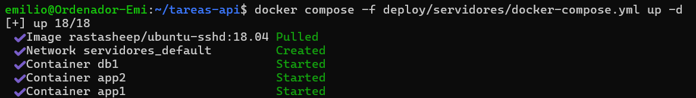

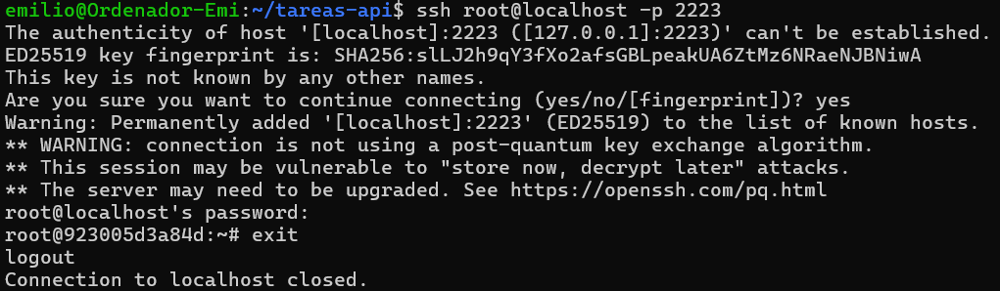

### Parte C — El inventario
Primero se créo el fichero `deploy/inventory.ini` relleado con los datos que incluye el boletín. Luego se instalo sshpass y se verificó la conexión de Ansible con la flota, donde se tomó esta captura:


### Parte D — El playbook de despliegue
Se creó `deploy/deploy.yml` con cl contenido del boletín, modificando la ruta de la imagen de la app en la parte de desplegar la API.

### Parte E — Proteger las credenciales con Ansible Vault
Primero se ejecutó `ansible-vault create deploy/group_vars/servidores/vault.yml
` para crear el fichero encriptado, y luego se introdujeron las creedenciales de github (ghcr) y las de la bbdd de la aplicación:

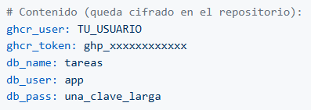

Luego se comprobó que se puede editar con `ansible-vault edit deploy/group_vars/servidores/vault.yml` (introduciendo la contraseña) y finalmente se ejecutó un **cat** para intentar leer el fichero. Lo que mostró fue una ristra de números, demostrando que realmente el fichero estaba encriptado y no se podia leer.

### Parte F — Ejecutar el despliegue a mano

Primero se lanzó el playbook con toda la flota, los `changed` podemos observarlos en la siguiente imagen:

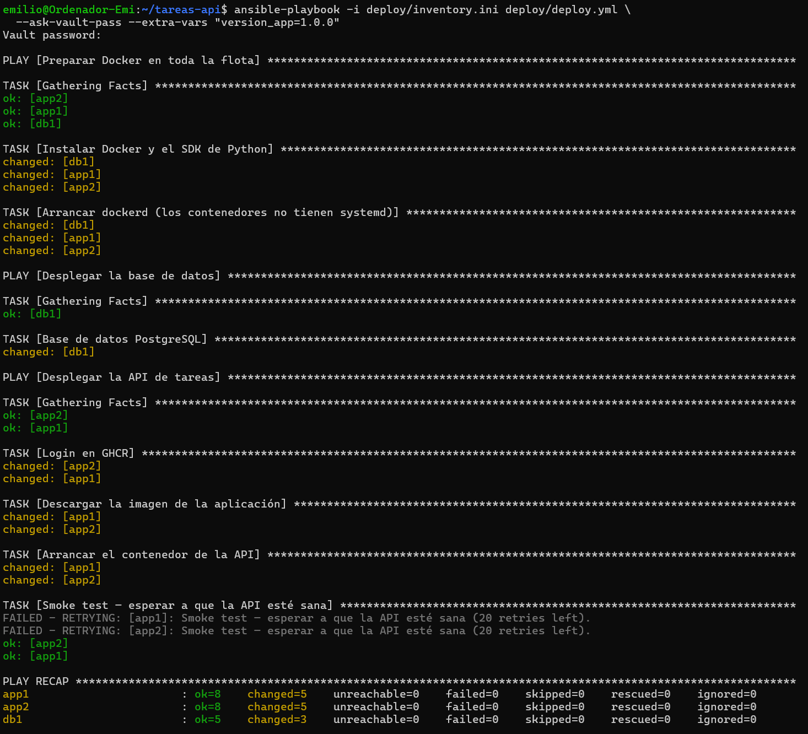

Posteriormente realizó la comprobación con curl de que la aplicación quedó corriendo en las dos réplicas. Después realizamos la misma operación viendo que Ansible nos informa de `changed=0`, demostrando la ejecución idempotente.

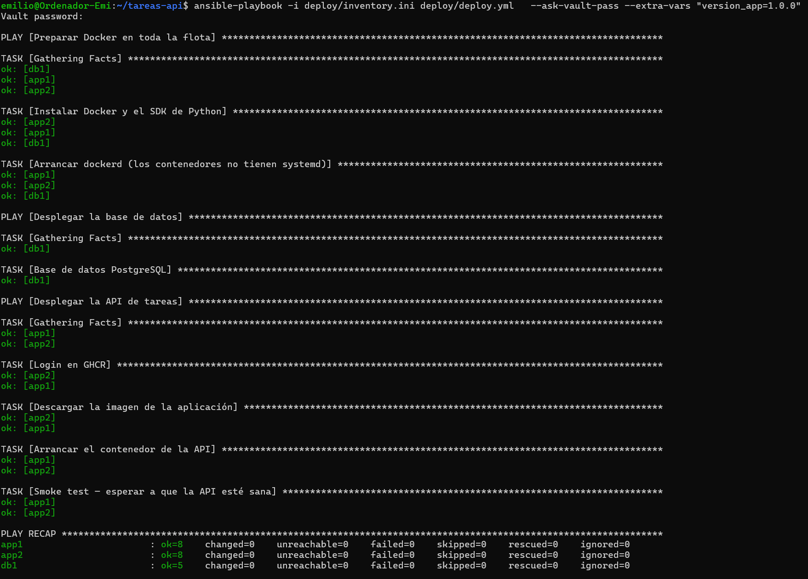

Para desplegar una versión nueva primero se publicó la versión con:

```bash
git tag -a v1.1.0 -m "Segunda versión publicable de la API de tareas"
git push origin v1.1.0
```

Una vez hecha la publicación se volvió a proceder al despliegue donde efectivamente encontramos cambios en `app1` y `app2`.

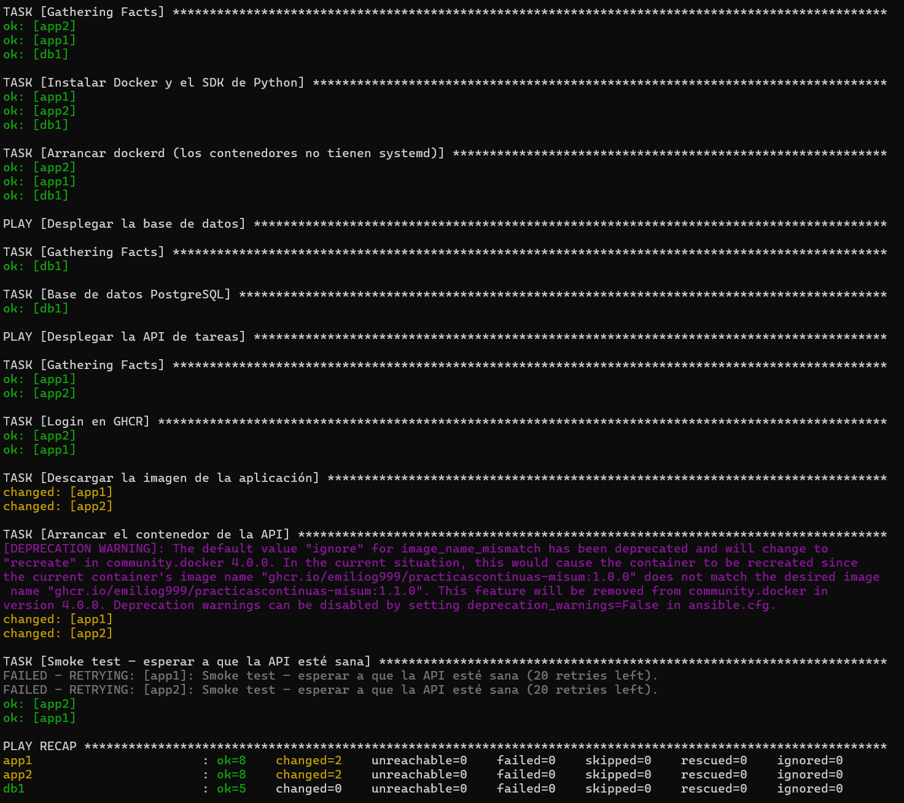

Realizamos el rollback que funciona debido a los tags inmutables, observamos de nuevo los cambios en las dos réplicas:

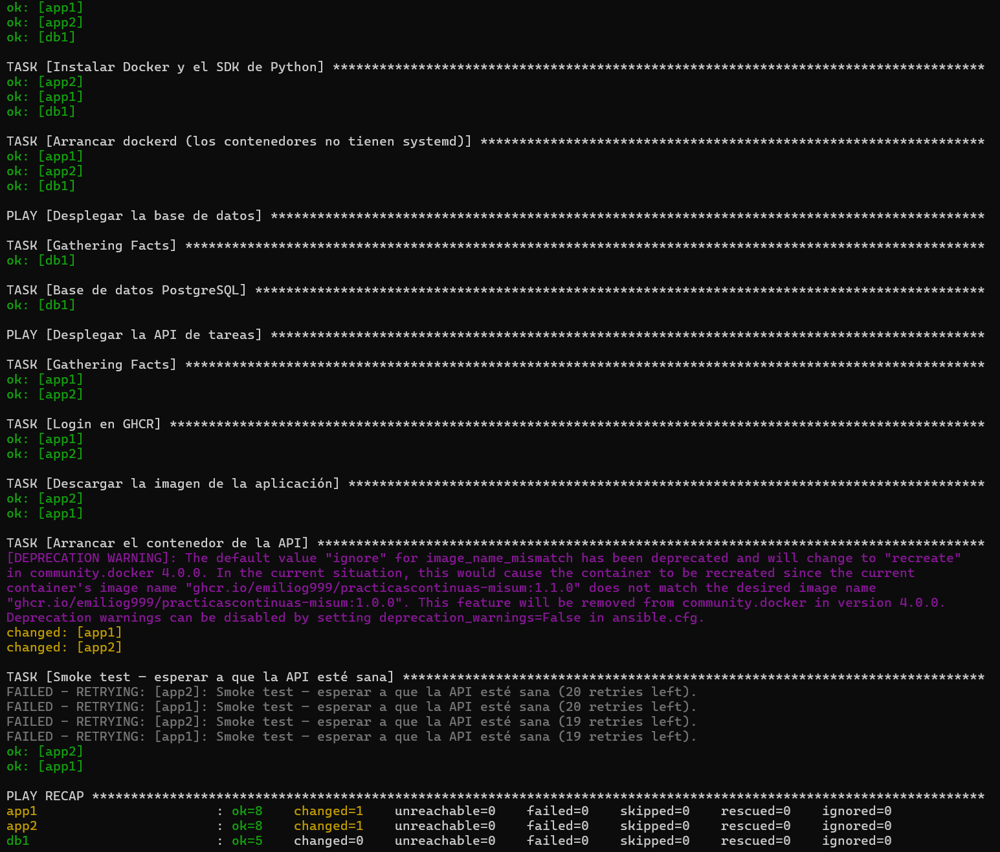

### Parte G — Disparar el despliegue desde GitHub Actions (cierre CD)

**G.1 — Runner autoalojado**

Se realizó el registro del runner en GitHub con `Settings → Actions → Runners → New self-hosted runner`. Posteriormente se ejecutaron en la máquina los comandos (y el token) dados por GitHub:

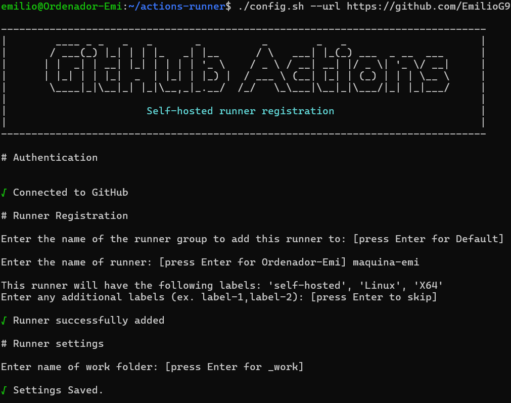

Después de pasar el formulario de `config.sh` se comprobó qeu el runner aparecía como `Idle` en `Settings → Actions → Runners`.

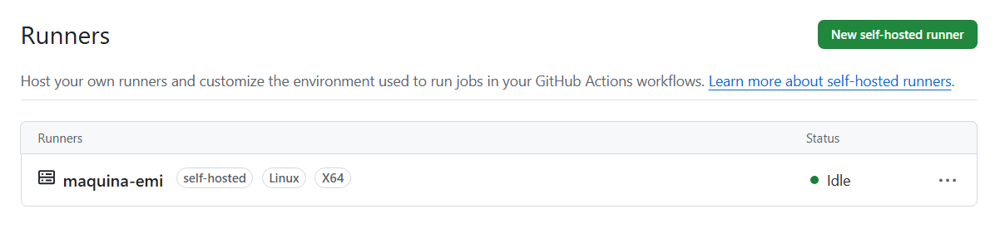

**G.2 — Entorno protegido y secreto del Vault** 

En GitHub creamos un entorno protegido `produccion` en `Settings → Environments → New environment` con las comprobaciones necesarias y un secret `VAULT_PASS` con la contraseña declarada en los apartados anteriores.

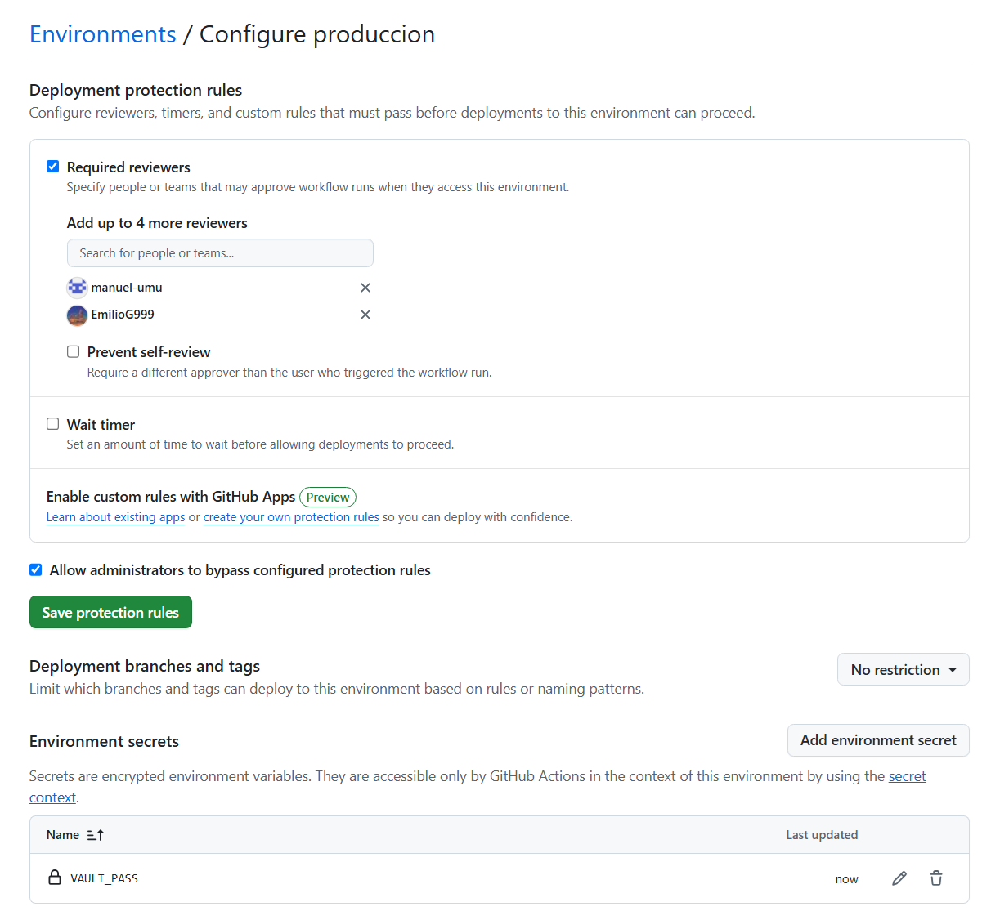

**G.3 — Ampliación de `release.yml`**
Se amplió el fichero `.github/workflows/release.yml` añadiendo un nuevo job (deploy). Este, se encarga de desplegar la aplicación en cuanto detecta una nueva versión. Para ello, requiere de la aprobación de alguien.

**G.4 — Prueba de extremo a extremo**

Se publicó una versión nueva con el runner en marcha y la flota levantada.
Revisamos GitHub Actions para ver `publish` ejecutándose y `deploy` esperando review:

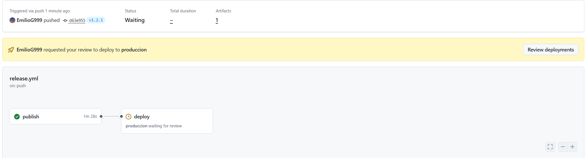

Procedemos a la realizar la aprobación del `deploy`:

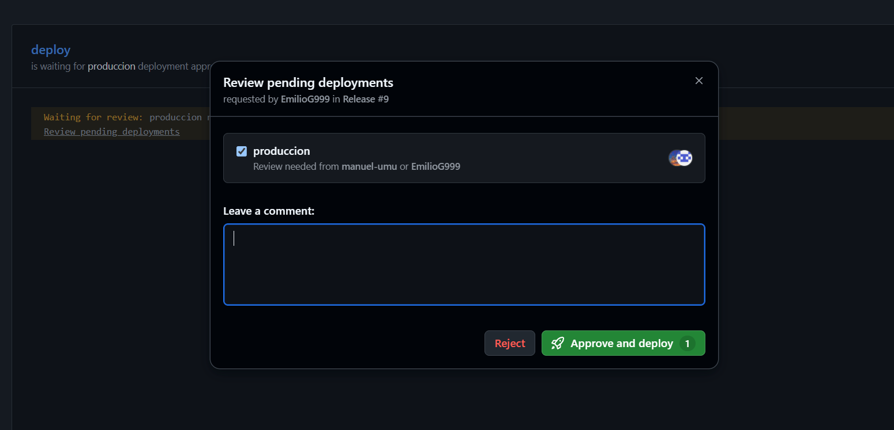

Y vemos como el runner recibe el trabajo:

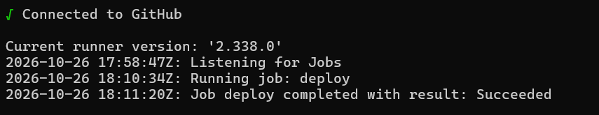

Por último comprobamos con ambos curls (`curl http://localhost:8081/api/tasks`) que se responde con la última versión en la última línea.

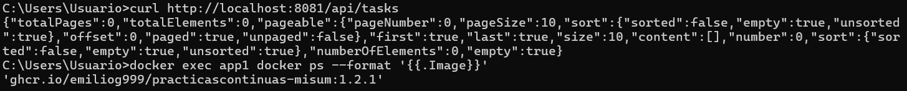

***Diagrama de la arquitectura***

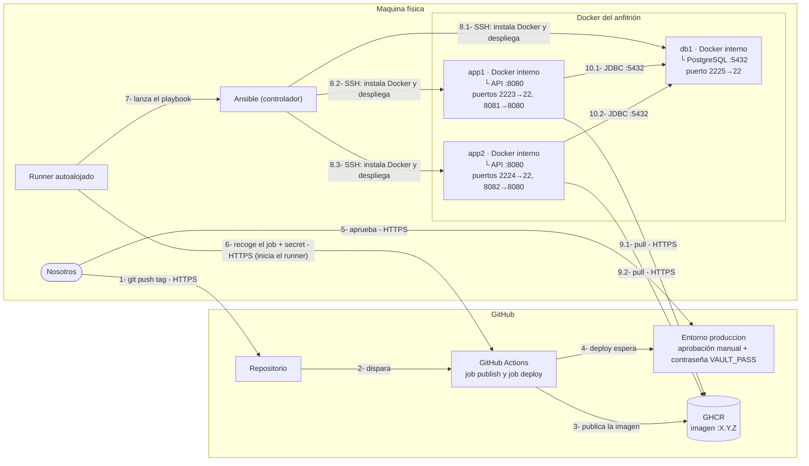
A modo de explicación, los pasos del despliegue serían los siguientes:

1. Se hace git push del tag vX.Y.Z.
2. El push lanza el workflow en GitHub Actions.
3. El job publish construye la imagen y la sube a GHCR.
4. El job deploy se queda esperando en el entorno produccion.
5. Se aprueba el despliegue.
6. El runner, que pregunta a GitHub cada poco tiempo, recoge el job junto con la contraseña del vault.
7. El runner ejecuta Ansible en el ordenador.
8. Ansible entra por SSH en db1, app1 y app2, instala Docker y despliega PostgreSQL y la API.
9. app1 y app2 descargan la imagen :X.Y.Z de GHCR.
10. Las dos APIs arrancan y se conectan a la base de datos de db1, que queda disponible en localhost:8081 y localhost:8082.